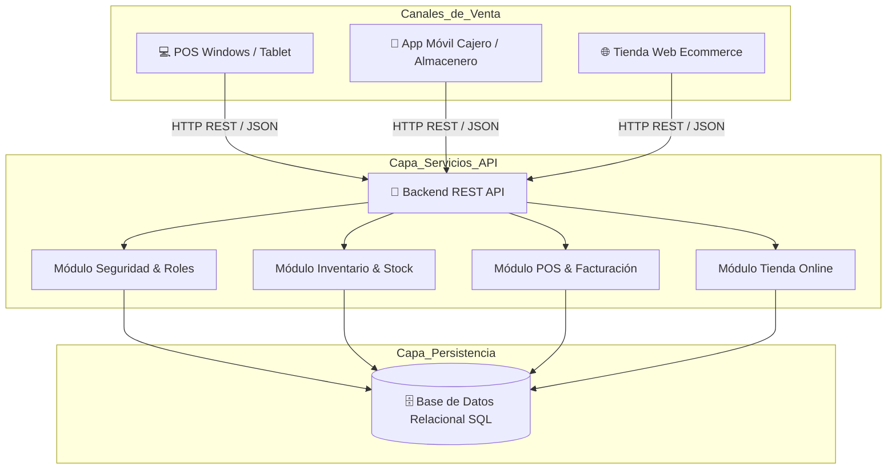
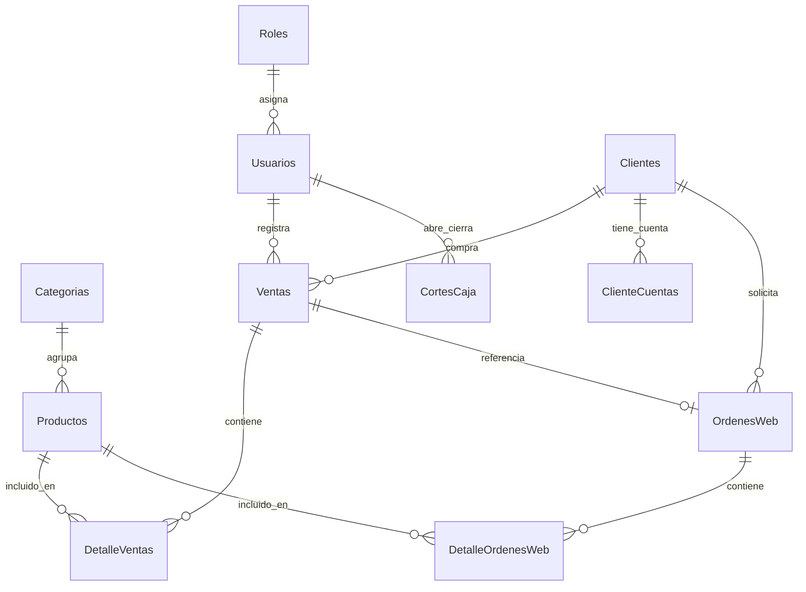
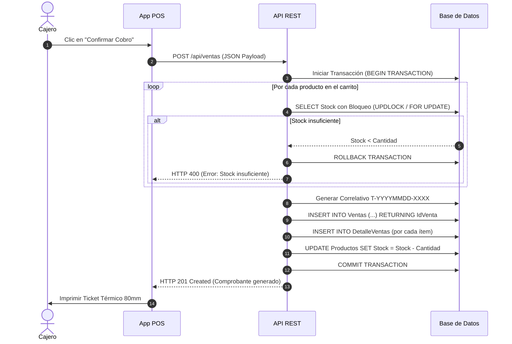

# Documento Maestro de Especificación: Sistema de Almacén, POS & Ecommerce

> **Guía Técnica de Referencia para Recreación del Sistema en Cualquier Lenguaje**  
> *(Node.js/Express, C#/.NET, Python/FastAPI, Java/Spring Boot, PHP/Laravel, Go, React, Vue, Angular, etc.)*

---

## 1. Visión General y Arquitectura

El sistema es una plataforma integral de **Gestión de Almacén, Inventario, Terminal Punto de Venta (POS) y Comercio Electrónico (Ecommerce)** diseñada para operar con inventario unificado en tiempo real.

### Principios Fundamentales
1. **Inventario Único Centralizado:** Las ventas presenciales en el POS y los pedidos realizados por clientes en la tienda online descuentan del mismo stock físico en tiempo real, evitando discrepancias y sobreventas (*over-selling*).
2. **Atomicidad Transaccional (ACID):** Toda operación que modifique stock (ventas, anulaciones, compras, pedidos web) se ejecuta bajo transacciones de base de datos con bloqueo de registros (*row locking*). Si un paso falla, se revierte todo (*rollback*).
3. **Desacoplamiento Total:** La interfaz de usuario (Frontend) no accede directamente a la base de datos; se comunica exclusivamente mediante una **API RESTful** con respuestas en formato JSON estandarizado.
4. **Diseño Adaptativo (Responsive):** La interfaz se adapta automáticamente a pantallas de escritorio/tablets (mediante barra de navegación lateral fija) y dispositivos móviles (mediante menú hamburguesa inferior/deslizable).



---

## 2. Modelo de Datos Relacional

A continuación se define el esquema relacional con sus tipos de datos estándar ANSI-SQL, claves primarias (`PK`), foráneas (`FK`), restricciones y valores por defecto.



### Diccionario de Datos

#### 1. Tabla `Roles`
Define los niveles de acceso del personal.
- `IdRol` (INT, PK, AutoIncrement): Identificador único.
- `Nombre` (VARCHAR(50), NOT NULL): 'Administrador', 'Supervisor', 'Cajero'.
- `Descripcion` (VARCHAR(150), NULL): Detalle de responsabilidades.

#### 2. Tabla `Usuarios`
Credenciales del personal interno.
- `IdUsuario` (INT, PK, AutoIncrement)
- `IdRol` (INT, FK -> `Roles.IdRol`, NOT NULL)
- `Usuario` (VARCHAR(50), UNIQUE, NOT NULL): Nombre de usuario para login.
- `Nombre` (VARCHAR(100), NOT NULL): Nombre completo del empleado.
- `Email` (VARCHAR(100), NULL)
- `Telefono` (VARCHAR(30), NULL)
- `Clave` (VARCHAR(255), NOT NULL): Contraseña hasheada (SHA-256 o BCrypt).
- `Estado` (BOOLEAN/BIT, DEFAULT 1): 1 = Activo, 0 = Inactivo.
- `FechaCreacion` (TIMESTAMP/DATETIME2, DEFAULT CURRENT_TIMESTAMP)

#### 3. Tabla `Categorias`
Clasificación de productos.
- `IdCategoria` (INT, PK, AutoIncrement)
- `Nombre` (VARCHAR(100), NOT NULL)
- `Descripcion` (VARCHAR(255), NULL)
- `Estado` (BOOLEAN/BIT, DEFAULT 1)

#### 4. Tabla `Productos`
Catálogo maestro de inventario compartido por POS y Ecommerce.
- `IdProducto` (INT, PK, AutoIncrement)
- `IdCategoria` (INT, FK -> `Categorias.IdCategoria`, NOT NULL)
- `Codigo` (VARCHAR(100), UNIQUE, NOT NULL): Código de barras (EAN-13, UPC o personalizado).
- `Nombre` (VARCHAR(150), NOT NULL)
- `Descripcion` (TEXT, NULL)
- `PrecioCompra` (DECIMAL(10,2), NOT NULL, DEFAULT 0.00): Costo de adquisición.
- `PrecioVenta` (DECIMAL(10,2), NOT NULL, DEFAULT 0.00): Precio al público.
- `Stock` (INT, NOT NULL, DEFAULT 0): Existencias físicas reales.
- `StockMinimo` (INT, NOT NULL, DEFAULT 5): Umbral para alertas de reabastecimiento.
- `Imagen` (VARCHAR(255), NULL): URL o ruta de imagen.
- `Estado` (BOOLEAN/BIT, DEFAULT 1): Eliminación lógica (1 = Visible, 0 = Descontinuado).
- `FechaCreacion` (TIMESTAMP/DATETIME2, DEFAULT CURRENT_TIMESTAMP)

#### 5. Tabla `Clientes`
Directorio de personas y empresas compradoras.
- `IdCliente` (INT, PK, AutoIncrement)
- `TipoPersona` (VARCHAR(30), NOT NULL, DEFAULT 'Natural'): 'Natural' o 'Juridica' (Empresa).
- `Nombre` (VARCHAR(150), NOT NULL): Nombre o Razón Social.
- `TipoDocumento` (VARCHAR(30), NULL, DEFAULT 'DUI'): 'DUI', 'NIT', 'Pasaporte'.
- `NumDocumento` (VARCHAR(50), NULL): Número de identidad fiscal/personal.
- `Telefono` (VARCHAR(30), NULL)
- `Email` (VARCHAR(100), NULL)
- `Direccion` (VARCHAR(255), NULL)
- `Nrc` (VARCHAR(50), NULL): Número de Registro de Contribuyente (aplica a empresas).
- `Giro` (VARCHAR(150), NULL): Actividad comercial o rubro empresarial.
- `FechaCreacion` (TIMESTAMP/DATETIME2, DEFAULT CURRENT_TIMESTAMP)

> [!NOTE]
> El registro con `IdCliente = 1` debe existir siempre como **"Consumidor Final"** (`NumDocumento = '00000000-0'`). Es el cliente por defecto en ventas rápidas donde no se solicitan datos fiscales.

#### 6. Tabla `CortesCaja` (Arqueo / Turnos POS)
- `IdCorte` (INT, PK, AutoIncrement)
- `IdUsuario` (INT, FK -> `Usuarios.IdUsuario`, NOT NULL)
- `MontoInicial` (DECIMAL(10,2), NOT NULL, DEFAULT 0.00): Fondo inicial de caja.
- `TotalVentas` (DECIMAL(10,2), NOT NULL, DEFAULT 0.00): Ventas acumuladas en efectivo del turno.
- `MontoFinal` (DECIMAL(10,2), NULL): Conteo físico del dinero al cierre.
- `Diferencia` (DECIMAL(10,2), NOT NULL, DEFAULT 0.00): `MontoFinal - (MontoInicial + TotalVentas)`.
- `FechaApertura` (TIMESTAMP/DATETIME2, DEFAULT CURRENT_TIMESTAMP)
- `FechaCierre` (TIMESTAMP/DATETIME2, NULL)
- `Estado` (VARCHAR(20), DEFAULT 'Abierta'): 'Abierta' o 'Cerrada'.

#### 7. Tabla `Ventas` (Comprobantes / Facturas emitidas)
- `IdVenta` (INT, PK, AutoIncrement)
- `IdCliente` (INT, FK -> `Clientes.IdCliente`, NOT NULL)
- `IdUsuario` (INT, FK -> `Usuarios.IdUsuario`, NOT NULL)
- `TipoComprobante` (VARCHAR(30), NOT NULL, DEFAULT 'Ticket'): 'Ticket', 'Factura', 'Credito Fiscal'.
- `NumComprobante` (VARCHAR(50), NOT NULL): Formato correlativo `T-YYYYMMDD-XXXX`.
- `MetodoPago` (VARCHAR(50), NOT NULL, DEFAULT 'Efectivo'): 'Efectivo', 'Tarjeta', 'Transferencia'.
- `Subtotal` (DECIMAL(10,2), NOT NULL)
- `Impuesto` (DECIMAL(10,2), NOT NULL): Valor del IVA (13%).
- `Total` (DECIMAL(10,2), NOT NULL)
- `PagoCon` (DECIMAL(10,2), NULL): Importe entregado por el cliente en efectivo.
- `Cambio` (DECIMAL(10,2), NULL): Monto devuelto como cambio.
- `Estado` (VARCHAR(30), DEFAULT 'Completada'): 'Completada' o 'Anulada'.
- `FechaHora` (TIMESTAMP/DATETIME2, DEFAULT CURRENT_TIMESTAMP)

#### 8. Tabla `DetalleVentas`
- `IdDetalle` (INT, PK, AutoIncrement)
- `IdVenta` (INT, FK -> `Ventas.IdVenta` ON DELETE CASCADE, NOT NULL)
- `IdProducto` (INT, FK -> `Productos.IdProducto`, NOT NULL)
- `Cantidad` (INT, NOT NULL)
- `Precio` (DECIMAL(10,2), NOT NULL): Precio unitario histórico al momento de la venta.
- `Descuento` (DECIMAL(10,2), DEFAULT 0.00)
- `Subtotal` (DECIMAL(10,2), NOT NULL): `(Cantidad * Precio) - Descuento`.

#### 9. Tabla `ClienteCuentas` (Usuarios de la Tienda Web)
- `IdClienteCuenta` (INT, PK, AutoIncrement)
- `IdCliente` (INT, FK -> `Clientes.IdCliente` ON DELETE CASCADE, NOT NULL)
- `Email` (VARCHAR(100), UNIQUE, NOT NULL): Usuario de acceso web.
- `Clave` (VARCHAR(255), NOT NULL): Contraseña encriptada.
- `TokenRecuperacion` (VARCHAR(100), NULL)
- `Estado` (BOOLEAN/BIT, DEFAULT 1)
- `FechaRegistro` (TIMESTAMP/DATETIME2, DEFAULT CURRENT_TIMESTAMP)

#### 10. Tabla `OrdenesWeb` (Pedidos del Ecommerce)
- `IdOrden` (INT, PK, AutoIncrement)
- `IdCliente` (INT, FK -> `Clientes.IdCliente`, NOT NULL)
- `FechaOrden` (TIMESTAMP/DATETIME2, DEFAULT CURRENT_TIMESTAMP)
- `Total` (DECIMAL(10,2), NOT NULL)
- `EstadoPago` (VARCHAR(30), DEFAULT 'Pendiente'): 'Pendiente', 'Pagado', 'Rechazado'.
- `EstadoEnvio` (VARCHAR(30), DEFAULT 'Procesando'): 'Procesando', 'En Camino', 'Entregado', 'Cancelado'.
- `IdVenta` (INT, FK -> `Ventas.IdVenta`, NULL): Vínculo cuando el pedido web se factura formalmente.

#### 11. Tabla `DetalleOrdenesWeb`
- `IdDetalleOrden` (INT, PK, AutoIncrement)
- `IdOrden` (INT, FK -> `OrdenesWeb.IdOrden` ON DELETE CASCADE, NOT NULL)
- `IdProducto` (INT, FK -> `Productos.IdProducto`, NOT NULL)
- `Cantidad` (INT, NOT NULL)
- `Precio` (DECIMAL(10,2), NOT NULL)
- `Subtotal` (DECIMAL(10,2), NOT NULL)

---

## 3. Navegación y Shell Principal (UI Layout)

La aplicación implementa un patrón **Master-Detail Responsive**:

### 1. Pantallas Grandes (Escritorio Windows, Mac, Linux, Tablets en Horizontal > 800px)
- **Barra Lateral (`NavigationRail` fija a la izquierda):**
  - Ancho de 220px.
  - Logotipo y Nombre del Sistema en la parte superior.
  - Indicador del usuario conectado y su Rol con avatar circular.
  - Ítems de menú con iconos y texto activo con color de realce:
    1. 📊 **Dashboard** (`/dashboard`)
    2. 🛒 **Punto de Venta (POS)** (`/pos`)
    3. 📦 **Productos & Stock** (`/productos`)
    4. 🏷️ **Categorías** (`/categorias`)
    5. 🧾 **Historial de Ventas** (`/ventas`)
    6. 👥 **Clientes** (`/clientes`)
  - En la parte inferior: Botón **Cerrar Sesión** con confirmación.

### 2. Pantallas Pequeñas (Celulares Android / iOS < 800px)
- **Barra Superior (`AppBar`):**
  - Título de la pantalla actual.
  - Botón de Menú Hamburguesa a la izquierda que abre un `Drawer`.
  - Icono de perfil a la derecha.
- **Barra Inferior (`BottomNavigationBar`):**
  - Atajos directos a las pantallas más frecuentes:
    1. Dashboard
    2. POS
    3. Productos
    4. Ventas
- **Cajón Desplegable (`Drawer`):** Contiene las opciones secundarias (Clientes, Categorías, Configuración de Servidor, Cerrar Sesión).

---

## 4. Especificación Detallada de Pantallas y Modales

---

### Pantalla 1: Inicio de Sesión (`LoginScreen`)

#### Propósito
Punto de entrada de seguridad para autenticar a empleados (Administradores, Cajeros, Supervisores).

#### Elementos Visuales
- Tarjeta central flotante con sombras suaves.
- Encabezado con icono de almacén, título y subtítulo de bienvenida.
- Campo de texto **Usuario** (con icono de persona, validación de campo requerido).
- Campo de texto **Contraseña** (con icono de candado, botón de alternar visibilidad ojo abierto/cerrado).
- Botón prominente **"Iniciar Sesión"** con indicador de carga giratorio mientras consulta al servidor.
- Sección de **"Usuarios de prueba"** con chips/botones rápidos (`Admin`, `Cajero`) que rellenan automáticamente los campos para pruebas ágiles.
- Icono de engranaje ⚙️ en la esquina superior para acceder al **Modal de Configuración de Servidor**.

#### Modal: Configuración de Servidor (`ServerConfigDialog`)
- **Objetivo:** Permitir cambiar la URL de conexión a la API sin recompilar la app.
- **Campos:**
  - Campo de texto con la URL base actual (ej. `http://localhost:5100/api` o `http://192.168.1.50:5100/api`).
  - Chips de autocompletado: `Localhost (PC :5100)` y `Emulador Android (:5100)`.
- **Botones:** "Cancelar" y "Guardar". Al guardar, persiste la URL en el almacenamiento local (`SharedPreferences` o `localStorage`).

#### Lógica y Validación
1. Valida que `usuario` y `clave` no estén vacíos.
2. Envía petición `POST /api/auth/login` con `{ usuario, clave }`.
3. Si el servidor responde `success: true`:
   - Guarda el token de sesión y los datos del usuario en almacenamiento local.
   - Redirige inmediatamente al **HomeScreen** (Dashboard/POS).
4. Si el servidor responde error (credenciales inválidas o usuario inactivo):
   - Muestra un SnackBar o alerta roja con el mensaje de error exacto.

---

### Pantalla 2: Dashboard (`DashboardScreen`)

#### Propósito
Panel ejecutivo que resume la salud operativa del negocio en tiempo real.

#### Elementos Visuales
- **Fila de 4 Tarjetas de Métricas (KPIs):**
  1. 💵 **Ventas de Hoy:** Muestra la suma total facturada hoy en formato moneda (`$0.00`) y el conteo de transacciones.
  2. 📦 **Total Productos:** Conteo de productos activos en el catálogo.
  3. ⚠️ **Alerta Bajo Stock:** Conteo de productos cuyo inventario es $\le$ al stock mínimo (con color de alerta naranja/rojo).
  4. 👥 **Clientes Registrados:** Total de clientes en la base de datos.
- **Acciones Rápidas:** Botones directos para *"Nueva Venta POS"*, *"Agregar Producto"* y *"Ver Historial"*.
- **Tabla / Lista de Alerta de Inventario:** Lista con los artículos más críticos (código, nombre, stock actual y stock mínimo).
- **Feed de Últimas Ventas:** Lista con los últimos 6 comprobantes emitidos (correlativo, cliente, hora y total).

#### Lógica y Ciclo de Vida
- Al montarse (`onInit`), ejecuta `GET /api/dashboard`.
- Soporta gesto de arrastrar para actualizar (*Pull-to-refresh*).

---

### Pantalla 3: Terminal Punto de Venta (`PosScreen`)

#### Propósito
Terminal de facturación ultrarrápido para atención en mostrador, optimizado para lectores de código de barras y pantallas táctiles.

#### Diseño en Pantalla Dividida (Desktop / Tablet)
- **Panel Izquierdo (Catálogo de Productos - 60% del ancho):**
  - **Barra de Búsqueda y Lector:** Campo de texto enfocado continuamente.
    - Soporta escritura de texto (búsqueda predictiva por nombre).
    - Soporta pistolas lectoras de código de barras USB/Bluetooth (al disparar un código y enviar Enter, busca y agrega el producto al carrito automáticamente).
  - **Filtro de Categorías:** Chips horizontales deslizables (`Todos`, `Bebidas`, `Snacks`, etc.).
  - **Grid de Productos:** Tarjetas con nombre, código, precio unitario grande, chip de existencias (`Stock: X`) y botón táctil para agregar (+). Si el stock es 0, la tarjeta se atenúa y se deshabilita.
- **Panel Derecho (Carrito de Compra Activo - 40% del ancho):**
  - **Selector de Cliente:** Dropdown con buscador de clientes. Por defecto selecciona `Consumidor Final`. Incluye botón `+` para registrar un cliente nuevo sin salir del POS.
  - **Selector de Comprobante:** Selector entre `Ticket`, `Factura` o `Crédito Fiscal`.
  - **Lista de Artículos en Carrito:** Cada fila incluye:
    - Nombre del producto y precio unitario.
    - Controles interactivos: botón `-`, caja de texto editable con la cantidad, botón `+`.
    - Subtotal de la línea.
    - Botón de eliminar (ícono papelera).
  - **Resumen Financiero Fijo en la parte inferior:**
    - `Subtotal:` Valor neto sin impuestos.
    - `IVA (13%):` Impuesto calculado.
    - `TOTAL:` Monto total a cobrar destacado en tipografía grande.
  - **Botones de Acción:**
    - Botón rojo secundario: *"Vaciar Carrito"*.
    - Botón verde principal: *"Cobrar ($XX.XX)"*. Deshabilitado si el carrito está vacío.

#### Modal: Procesar Cobro y Pago (`PaymentDialog`)
Se abre al presionar *"Cobrar"*.
- **Selector de Método de Pago:** Chips interactivos para `Efectivo`, `Tarjeta de Débito/Crédito` o `Transferencia`.
- **Si el método es Efectivo:**
  - Campo numérico *"¿Con cuánto paga el cliente?"*.
  - **Fila de Atajos de Billetes Rápidos:** Botones con denominaciones comunes (`$1`, `$5`, `$10`, `$20`, `$50`, `$100`) y botón *"Pago Exacto"*. Al presionar uno, rellena el campo automáticamente.
  - **Caja de Cambio en Tiempo Real:** Muestra el cambio a devolver en color verde destacado. Si el monto ingresado es menor al total, muestra una advertencia en rojo *"Monto insuficiente"*.
- **Botón "Confirmar y Emitir Ticket":** Ejecuta la transacción atómica.

#### Modal: Previsualización e Impresión de Ticket Térmico (`TicketPreviewDialog`)
Se abre tras confirmar el cobro con éxito.
- Genera un documento PDF formateado exactamente para impresoras térmicas de tickets de **80mm** (y compatible con 58mm).
- **Contenido del Ticket:**
  - Encabezado con Nombre del Negocio, Teléfono y Dirección.
  - Número de Comprobante (`T-YYYYMMDD-XXXX`).
  - Fecha y hora exacta de emisión.
  - Nombre del Cajero y Nombre del Cliente.
  - Tabla de artículos: Cantidad, Descripción, Precio Unitario, Total línea.
  - Resumen: Subtotal, IVA (13%), TOTAL.
  - Desglose de pago: `Método: Efectivo`, `Pagó con: $XX.XX`, `Su cambio: $XX.XX`.
  - Pie de página: *"¡Gracias por su compra! Vuelva pronto"*.
- **Acciones:**
  - Botón **"Imprimir Directo"**: Llama al driver nativo de impresión del sistema operativo.
  - Botón **"Nueva Venta"**: Limpia el carrito y vuelve a enfocar el buscador de productos.

---

### Pantalla 4: Gestión de Productos (`ProductosScreen`)

#### Propósito
Control maestro de inventario, altas, bajas, modificaciones y auditoría de existencias.

#### Elementos Visuales
- Barra superior con buscador y filtro por categoría.
- Botón destacado `+ Nuevo Producto`.
- Tabla o lista de productos con columnas:
  - Imagen/Miniatura.
  - Código de barras (con icono de código de barras).
  - Nombre y Categoría.
  - Precio de Compra y Precio de Venta.
  - **Margen de Ganancia calculado:** `((PrecioVenta - PrecioCompra) / PrecioCompra) * 100%`.
  - **Badge de Stock:**
    - Verde si `Stock > StockMinimo`.
    - Naranja si `Stock <= StockMinimo`.
    - Rojo si `Stock == 0` (Agotado).
  - Menú de acciones por fila: `Editar` y `Eliminar`.

#### Modal: Crear / Editar Producto (`ProductFormModal`)
- **Campos:**
  - Selector de **Categoría** (Dropdown cargado dinámicamente).
  - **Código de Barras:** Con botón anexo *"Generar Aleatorio"* que produce un código único de 13 dígitos numéricos.
  - **Nombre del Producto.**
  - **Descripción** (opcional).
  - **Precio de Compra ($)** y **Precio de Venta ($)**.
  - **Stock Inicial / Actual** (entero $\ge 0$).
  - **Stock Mínimo** (umbral de alerta, por defecto 5).
- **Validaciones:**
  - El código de barras no puede repetirse con ningún producto existente.
  - `PrecioVenta` debe ser mayor o igual a `PrecioCompra`.
  - `Stock` no puede ser negativo.

---

### Pantalla 5: Categorías (`CategoriasScreen`)

#### Propósito
Organización de los departamentos o familias de productos.

#### Elementos Visuales
- Lista de categorías con nombre, descripción y contador dinámico de cuántos productos pertenecen a esa categoría (`Total productos: X`).
- Botón `+ Nueva Categoría`.
- Modal emergente para ingresar Nombre y Descripción.

---

### Pantalla 6: Historial de Ventas (`VentasScreen`)

#### Propósito
Auditoría de facturación, reimpresión de comprobantes y anulación de ventas con reposición de inventario.

#### Elementos Visuales
- Filtro por selector de fecha y buscador por correlativo o cliente.
- Lista de ventas con número de ticket, fecha/hora, cliente, cajero, método de pago, total y badge de estado:
  - 🟢 **Completada**
  - 🔴 **Anulada**
- Al tocar una venta se abre el **Modal de Detalle de Venta**:
  - Muestra todos los productos que integraron esa venta específica.
  - Botón **"Reimprimir Ticket"** (vuelve a generar el PDF térmico).
  - Botón **"Anular Venta"** (solo visible si la venta está en estado `Completada`).

#### Modal de Confirmación: Anular Venta
- Muestra una advertencia crítica:  
  *"¿Está seguro de anular la venta T-XXXX? Esta acción devolverá automáticamente todas las unidades al inventario y marcará el ticket como Anulado."*
- Botones: *"Cancelar"* y *"Sí, Anular y Devolver Stock"*.

---

### Pantalla 7: Directorio de Clientes (`ClientesScreen`)

#### Propósito
Mantenimiento de clientes para emisión de comprobantes fiscales.

#### Elementos Visuales
- Buscador por Nombre, DUI, NIT o Teléfono.
- Pestañas o filtro: `Todos`, `Personas Naturales`, `Empresas (Jurídicas)`.
- Modal de Alta/Edición con campos diferenciados:
  - Selector: `Persona Natural` vs `Persona Jurídica (Empresa)`.
  - Si es Natural: Nombre, DUI (formato `########-#`), Teléfono, Dirección, Email.
  - Si es Empresa: Razón Social, NIT (`####-######-###-#`), NRC (Registro de Contribuyente), Giro o Rubro Económico, Dirección, Teléfono, Email.

---

### Pantalla 8: Control de Caja / Arqueo (`CortesScreen`)

#### Propósito
Control de flujo de dinero en efectivo para evitar descuadres entre turnos de cajeros.

#### Lógica de Funcionamiento
1. **Apertura de Caja (`POST /api/corte/abrir`):**
   - El cajero ingresa el fondo de caja inicial (ej. `$50.00` en cambio).
   - Se crea el registro con `Estado = 'Abierta'`.
2. **Operación del Turno:**
   - Cada venta en efectivo suma automáticamente al campo `TotalVentas` del turno activo.
3. **Cierre de Caja / Arqueo (`POST /api/corte/cerrar`):**
   - El cajero o supervisor cuenta físicamente los billetes y monedas en la gaveta y digita el `MontoFinal`.
   - El sistema calcula:
     $$\text{Esperado en Caja} = \text{MontoInicial} + \text{TotalVentas}$$
     $$\text{Diferencia} = \text{MontoFinal} - \text{Esperado en Caja}$$
   - Si $\text{Diferencia} == 0$: *"Caja Cuadrada"*.
   - Si $\text{Diferencia} < 0$: *"Faltante de -\$X.XX"*.
   - Si $\text{Diferencia} > 0$: *"Sobrante de +\$X.XX"*.
   - Cierra el registro con fecha/hora final y bloquea nuevas ventas hasta una nueva apertura.

---

## 5. Lógica de Negocio y Reglas Transaccionales

Esta sección describe el algoritmo paso a paso que cualquier desarrollador debe programar en el backend, independientemente del lenguaje o base de datos elegida.

---

### 5.1 Reglas del Inventario y Prevención de Sobreventas

1. **Atomicidad con Bloqueo de Fila:**
   Al procesar una venta o pedido web, la consulta del stock disponible **NO** debe ser una simple lectura; debe adquirir un bloqueo de actualización en la base de datos:
   - En T-SQL (SQL Server): `SELECT Stock FROM Productos WITH (UPDLOCK) WHERE IdProducto = @id`
   - En PostgreSQL / MySQL: `SELECT Stock FROM Productos WHERE IdProducto = :id FOR UPDATE`
2. **Validación de Existencia:**
   - Si $\text{Stock Actual} < \text{Cantidad Solicitada}$:
     La transacción debe cancelarse inmediatamente (`ROLLBACK`) y devolver error HTTP 400:  
     `"Stock insuficiente para '[Nombre]'. Disponible: X, solicitado: Y"`.
3. **Control en Interfaz de Usuario:**
   El carrito del POS valida localmente antes de enviar la petición: el botón `+` no permite incrementar la cantidad por encima del stock conocido en memoria.

---

### 5.2 Algoritmo Transaccional de Venta POS (6 Pasos Indivisibles)



#### Fórmulas de Cálculo Financiero
- **Cálculo de Impuestos (IVA 13% El Salvador / Adaptable a cualquier país):**
  - Los precios de venta al público en el mostrador usualmente ya incluyen IVA.
  - $\text{Total} = \sum (\text{Cantidad}_i \times \text{PrecioUnitario}_i - \text{Descuento}_i)$
  - $\text{Subtotal} = \frac{\text{Total}}{1 + \text{TasaIVA}} = \frac{\text{Total}}{1.13}$
  - $\text{Impuesto (IVA)} = \text{Total} - \text{Subtotal}$
- **Cálculo de Cambio:**
  - $\text{Cambio} = \text{PagoCon} - \text{Total}$ (si $\text{PagoCon} \ge \text{Total}$, de lo contrario error).

---

### 5.3 Algoritmo de Anulación de Venta con Reposición de Stock

1. Iniciar transacción en la base de datos.
2. Leer la venta con bloqueo:
   - Si la venta no existe $\rightarrow$ HTTP 404.
   - Si la venta ya tiene `Estado == 'Anulada'` $\rightarrow$ HTTP 400 *"Esta venta ya fue anulada anteriormente"*.
3. **Reintegrar las existencias al inventario:**
   ```sql
   UPDATE p
   SET p.Stock = p.Stock + dv.Cantidad
   FROM Productos p
   INNER JOIN DetalleVentas dv ON p.IdProducto = dv.IdProducto
   WHERE dv.IdVenta = @IdVenta;
   ```
4. **Cambiar estado de la venta:**
   ```sql
   UPDATE Ventas SET Estado = 'Anulada' WHERE IdVenta = @IdVenta;
   ```
5. Confirmar transacción (`COMMIT`).
6. Devolver HTTP 200 con confirmación. En el Frontend, el catálogo y las tablas de inventario se refrescan automáticamente.

---

### 5.4 Lógica del Módulo Ecommerce (Tienda Web)

1. **Catálogo Público (`GET /api/ecommerce/productos`):**
   - No requiere autenticación.
   - Solo retorna productos con `Estado = 1` y con `Stock > 0`. Los productos agotados se excluyen automáticamente para evitar que clientes web compren artículos inexistentes.
2. **Registro de Clientes Web (`POST /api/ecommerce/registro`):**
   - Inserta un registro en `Clientes` (datos de envío y contacto).
   - Inserta un registro en `ClienteCuentas` con el `IdCliente` asociado y la contraseña hasheada.
3. **Generación de Pedidos Web (`POST /api/ecommerce/ordenes`):**
   - Funciona idéntico a la venta del POS: valida stock en tiempo real y descuenta el inventario físico inmediatamente al recibir la orden en estado `Procesando`.
   - De esta manera, si en la tienda física solo queda 1 unidad y alguien la compra por internet, el POS físico detectará al instante que el stock es 0, impidiendo la sobreventa.

---

## 6. Especificación del Contrato API REST (Endpoints & JSON)

Cualquier backend que se construya para reemplazar o replicar el actual debe respetar estos contratos de entrada y salida:

### Formato Estándar de Respuesta
```json
{
  "success": true,
  "message": "Mensaje descriptivo",
  "data": { ... }
}
```

---

### 1. Autenticación (`POST /api/auth/login`)
- **Request:**
  ```json
  {
    "usuario": "admin",
    "clave": "admin123"
  }
  ```
- **Response (200 OK):**
  ```json
  {
    "success": true,
    "message": "Inicio de sesión exitoso",
    "data": {
      "user": {
        "id_usuario": 1,
        "id_rol": 1,
        "usuario": "admin",
        "nombre": "Administrador General",
        "email": "admin@almacen.com",
        "telefono": "7000-0000",
        "rol": "Administrador"
      },
      "token": "bba9970e806e13121539bda8c75a8f29"
    }
  }
  ```

---

### 2. Dashboard (`GET /api/dashboard`)
- **Response (200 OK):**
  ```json
  {
    "success": true,
    "data": {
      "ventas_hoy": {
        "conteo": 12,
        "total": 145.50
      },
      "total_productos": 150,
      "total_bajo_stock": 3,
      "productos_bajo_stock": [
        {
          "id_producto": 1,
          "codigo": "7501055312108",
          "nombre": "Coca Cola 500ml",
          "stock": 3,
          "stock_minimo": 10,
          "categoria": "Bebidas y Snacks"
        }
      ],
      "total_clientes": 45,
      "ultimas_ventas": [
        {
          "id_venta": 101,
          "num_comprobante": "T-20260904-0012",
          "total": 15.00,
          "metodo_pago": "Efectivo",
          "estado": "Completada",
          "fecha_hora": "2026-09-04 12:30:15",
          "cliente_nombre": "Consumidor Final"
        }
      ]
    }
  }
  ```

---

### 3. Registrar Venta POS (`POST /api/ventas`)
- **Request:**
  ```json
  {
    "id_cliente": 1,
    "id_usuario": 1,
    "tipo_comprobante": "Ticket",
    "metodo_pago": "Efectivo",
    "subtotal": 2.39,
    "impuesto": 0.31,
    "total": 2.70,
    "pago_con": 5.00,
    "cambio": 2.30,
    "items": [
      {
        "id_producto": 1,
        "cantidad": 3,
        "precio": 0.90,
        "descuento": 0.00,
        "subtotal": 2.70
      }
    ]
  }
  ```
- **Response (201 Created):**
  ```json
  {
    "success": true,
    "message": "Venta registrada exitosamente",
    "data": {
      "id_venta": 102,
      "num_comprobante": "T-20260904-0013",
      "total": 2.70,
      "fecha_hora": "2026-09-04 13:15:00"
    }
  }
  ```

---

### 4. Anular Venta (`POST /api/ventas/anular`)
- **Request:**
  ```json
  {
    "id_venta": 102
  }
  ```
- **Response (200 OK):**
  ```json
  {
    "success": true,
    "message": "Venta anulada y stock devuelto exitosamente",
    "data": {
      "id_venta": 102
    }
  }
  ```

---

## 7. Guía Paso a Paso para Recrear este Sistema en Otro Lenguaje

Si tú o tu equipo desean recrear este sistema en otra tecnología (por ejemplo, **React/Vue + Node.js/NestJS**, o **Python/FastAPI + Angular**, etc.), sigan este orden de ejecución:

1. **Fase 1: Base de Datos Relacional**
   - Ejecutar el script DDL con las 11 tablas descritas en la Sección 2.
   - Configurar claves primarias autoincrementales y relaciones con integridad referencial (`FOREIGN KEY`).
   - Insertar datos semilla esenciales: Roles (`Admin`, `Cajero`), usuario `admin`, cliente `Consumidor Final` (Id 1) y categorías iniciales.

2. **Fase 2: Backend & Conexión ACID**
   - Configurar el pool de conexiones a la base de datos.
   - Implementar CORS abierto o configurable para permitir peticiones desde clientes de escritorio, web o móviles.
   - Crear el módulo de Autenticación con hash de contraseñas.
   - Programar los endpoints CRUD para `Productos`, `Categorias` y `Clientes`.
   - **Crucial:** Implementar el endpoint `POST /api/ventas` utilizando transacciones y bloqueos de fila (`FOR UPDATE` o `UPDLOCK`). Nunca descontar inventario sin verificar existencias dentro de la misma transacción.

3. **Fase 3: Módulo Ecommerce en el Backend**
   - Exponer `GET /api/ecommerce/productos` filtrando `stock > 0`.
   - Exponer el registro y login de usuarios de la tienda web.
   - Exponer `POST /api/ecommerce/ordenes` asegurando que descuente del mismo campo `Stock` en la tabla `Productos`.

4. **Fase 4: Frontend - Shell y Autenticación**
   - Diseñar el layout responsivo (menú lateral en escritorio, barra inferior en móviles).
   - Crear la pantalla de login conectada al endpoint de autenticación.
   - Guardar el token en almacenamiento persistente de la sesión.

5. **Fase 5: Frontend - Terminal POS y Catálogos**
   - Desarrollar la pantalla POS con split-view (catálogo y carrito).
   - Conectar el lector de código de barras: debe escuchar el evento `onKey` o `onChange` del teclado para buscar y añadir productos instantáneamente al detectar el código.
   - Implementar la lógica del carrito reactivo: suma automática de subtotal, IVA (13%) y total.
   - Desarrollar el modal de cobro con cálculo de cambio y atajos de billetes.
   - Integrar la biblioteca de generación de PDFs para imprimir tickets térmicos en formato 80mm.

6. **Fase 6: Pruebas de Carga y Concurrencia**
   - Probar que al registrar una venta en el POS físico, el stock en la base de datos se reduzca de inmediato.
   - Probar que al anular la venta, el stock se incremente de nuevo a su valor original.
   - Probar que si un producto tiene 1 unidad en stock y dos clientes intentan comprarlo a la vez (uno en el POS y otro en la tienda web), solo uno tenga éxito y el segundo reciba el mensaje claro de *"Stock insuficiente"*.
