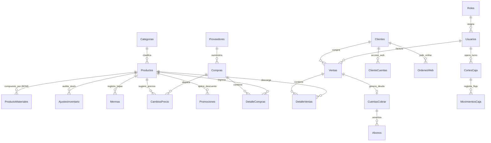
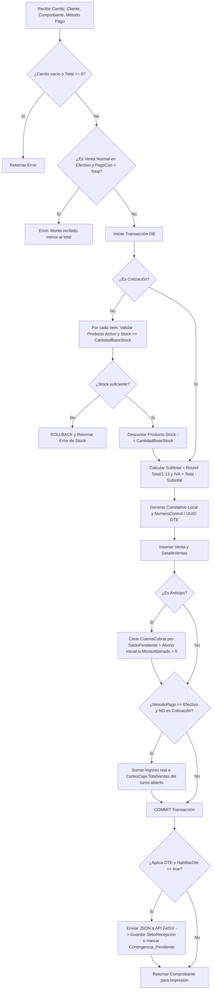

# Especificación Maestra de Lógica de Negocio: Coreas ERP

> **Propósito del Documento:** Guía de ingeniería agnóstica a la plataforma (aplicable a Web, Móvil, Desktop, Node.js, PHP, Python, Java, C#, Go, Flutter, React, etc.) que documenta el **100% de las reglas de negocio, fórmulas matemáticas, modelo de datos, flujos transaccionales y validaciones** de **Coreas ERP**.

---

## 1. Principios Arquitectónicos y Reglas Globales

1. **Inventario Único Centralizado y Fraccionable:**
   - El stock físico se almacena en la **unidad de empaque base** (`DECIMAL(12,3)`), permitiendo vender tanto **empaques cerrados** (cajas, paquetes, fardos) como **fracciones/unidades sueltas a granel** (sobres, unidades, libras) descontando proporcionalmente del mismo inventario.
2. **Atomicidad Transaccional (ACID):**
   - Toda operación que modifique existencias o saldos financieros (Ventas, Compras, Anulaciones, Abonos, Mermas, Ajustes) debe ejecutarse dentro de una **transacción de base de datos** (`BEGIN TRANSACTION ... COMMIT / ROLLBACK`) con bloqueo de fila (`SELECT ... FOR UPDATE` o `WITH (UPDLOCK)`).
3. **Inmutabilidad Histórica y Auditoría:**
   - Ningún producto con historial en `DetalleVentas` puede eliminarse físicamente (`DELETE`); solo puede desactivarse (`Estado = 0`).
   - Las ventas y compras no se borran; cambian su estado a `'Anulada'` revirtiendo su impacto en stock y caja.
   - Todo ajuste manual de stock, baja por merma o apertura de gaveta sin venta exige **autorización de Supervisor/Administrador** con contraseña y deja rastro en tablas de auditoría.
4. **Precios con Impuesto Incluido (IVA 13%):**
   - Los precios de venta al público (`PrecioVenta` y `PrecioGranel`) ya incluyen el IVA configurado (`TasaIva = 13%` por defecto). El desglose fiscal se calcula inversamente a partir del total.

---

## 2. Modelo de Datos Completo (19 Entidades)

### 2.1 Catálogo de Tablas y Campos Clave

| Tabla | Clave Primaria | Campos y Tipos Esenciales | Reglas de Integridad |
| :--- | :--- | :--- | :--- |
| **`Roles`** | `IdRol` (INT) | `Nombre` (VARCHAR 50: `'Administrador'`, `'Supervisor'`, `'Cajero'`), `Descripcion` | Semilla obligatoria: IDs 1, 2 y 3. |
| **`Usuarios`** | `IdUsuario` (INT) | `IdRol` (FK), `Usuario` (UNIQUE), `Nombre`, `Email`, `Telefono`, `Clave` (BCrypt Hash), `Estado` (BIT), `FechaCreacion` | No se borran; se desactivan con `Estado = 0`. |
| **`Categorias`** | `IdCategoria` (INT) | `Nombre`, `Descripcion`, `Icono` (`'fa-box'`), `ImagenUrl`, `Estado` (BIT) | Restricción `RESTRICT` al borrar si tiene productos. |
| **`Productos`** | `IdProducto` (INT) | `IdCategoria` (FK), `Codigo` (UNIQUE EAN/SKU), `Nombre`, `Descripcion`, `PrecioCompra` (DEC 10,2), `PrecioVenta` (DEC 10,2), `PrecioGranel` (DEC 10,2 NULL), `CostoGranel` (DEC 10,4 NULL), `CantidadPorEmpaque` (DEC 10,2 DEF 1), `Stock` (DEC 12,3), `StockMinimo` (DEC 12,3 DEF 5), `EsGranel` (BIT), `UnidadMedida` (VARCHAR 30), `MargenExcepcion` (DEC 5,2), `Imagen`, `ImagenUrl`, `Estado` (BIT) | `Stock` almacena unidades de empaque base con hasta 3 decimales. |
| **`ProductoMateriales`** | `IdProductoMaterial` | `IdProductoPadre` (FK), `IdProductoInsumo` (FK), `Cantidad` (DEC 10,2), `FechaCreacion` | `IdProductoPadre != IdProductoInsumo`. Receta/BOM. |
| **`Clientes`** | `IdCliente` (INT) | `TipoPersona` (`'Natural'`, `'Juridica'`), `Nombre`, `TipoDocumento` (`'DUI'`, `'NIT'`, `'Pasaporte'`), `NumDocumento`, `Telefono`, `Email`, `Direccion`, `Nrc`, `Giro`, `FechaCreacion` | `IdCliente = 1` es siempre `"Consumidor Final"` (`00000000-0`). |
| **`Proveedores`** | `IdProveedor` (INT) | `Nombre`, `Contacto`, `Telefono`, `Email`, `Direccion`, `Nrc`, `Nit`, `Estado` (BIT), `FechaCreacion` | Requerido para registrar ingresos de almacén (`Compras`). |
| **`Compras`** | `IdCompra` (INT) | `IdProveedor` (FK), `IdUsuario` (FK), `NumFactura`, `Total` (DEC 10,2), `FechaHora`, `Estado` (`'Completada'`, `'Anulada'`), `Observaciones` | Incrementa `Productos.Stock` y actualiza `PrecioCompra`. |
| **`DetalleCompras`** | `IdDetalleCompra` | `IdCompra` (FK CASCADE), `IdProducto` (FK), `Cantidad` (DEC 12,3), `PrecioCompra` (DEC 10,2), `Subtotal` (DEC 10,2) | `Subtotal = Cantidad * PrecioCompra`. |
| **`CambiosPrecio`** | `IdCambioPrecio` | `IdProducto` (FK), `IdCompra` (FK NULL), `CostoAnterior`, `CostoNuevo`, `PrecioVentaAnterior`, `PrecioVentaNuevo`, `MargenPorcentaje`, `Motivo`, `FechaHora`, `Estado` (`'Pendiente'`, `'Aplicado'`, `'Descartado'`), `FechaAplicacion` | Se genera automáticamente cuando cambia el costo en una compra. |
| **`Ventas`** | `IdVenta` (INT) | `IdCliente` (FK), `IdUsuario` (FK), `TipoComprobante`, `NumComprobante`, `MetodoPago`, `Subtotal`, `Impuesto`, `Total`, `PagoCon`, `Cambio`, `Estado` (`'Completada'`, `'Anulada'`, `'Cotización'`), `FechaHora`, `CodigoGeneracion` (UUID), `NumeroControl`, `SelloRecepcion`, `EstadoDte`, `DteId`, `RespuestaHacienda` | Soporta ventas normales, anticipos, cotizaciones y DTE. |
| **`DetalleVentas`** | `IdDetalle` (INT) | `IdVenta` (FK CASCADE), `IdProducto` (FK), `Cantidad` (DEC 12,3), `Precio` (DEC 10,2), `Descuento` (DEC 10,2), `Subtotal` (DEC 10,2) | `Precio` guarda el precio histórico aplicado (empaque o granel). |
| **`CuentasCobrar`** | `IdCuentaCobrar` | `IdVenta` (FK), `IdCliente` (FK), `MontoTotal` (DEC 10,2), `SaldoPendiente` (DEC 10,2), `FechaEmision`, `FechaVencimiento`, `Estado` (`'Pendiente'`, `'Pagada'`) | Generada en ventas tipo `'Anticipo'` o a `'Credito'`. |
| **`Abonos`** | `IdAbono` (INT) | `IdCuentaCobrar` (FK CASCADE), `IdUsuario` (FK), `Monto` (DEC 10,2), `MetodoPago`, `FechaHora`, `Notas` | Amortiza `SaldoPendiente` y suma a caja si es `'Efectivo'`. |
| **`CortesCaja`** | `IdCorte` (INT) | `IdUsuario` (FK), `MontoInicial`, `TotalVentas`, `MontoFinal`, `Diferencia`, `FechaApertura`, `FechaCierre`, `Estado` (`'Abierta'`, `'Cerrada'`) | Solo puede existir 1 caja `'Abierta'` por usuario a la vez. |
| **`MovimientosCaja`**| `IdMovimiento` | `IdCorte` (FK NULL), `IdUsuario` (FK), `Tipo` (`'Ingreso'`, `'Retiro'`, `'Gasto'`, `'AperturaGaveta'`), `Monto`, `Motivo`, `FechaHora` | Afecta el efectivo esperado en el arqueo del turno. |
| **`AjustesInventario`**| `IdAjuste` (INT) | `IdProducto` (FK), `IdUsuarioSupervisor` (FK), `StockAnterior`, `StockNuevo`, `Diferencia`, `Motivo`, `FechaHora` | Bitácora inmutable de correcciones de inventario físico. |
| **`Mermas`** | `IdMerma` (INT) | `IdProducto` (FK), `IdUsuarioSupervisor` (FK), `IdUsuarioCajero` (FK), `Cantidad`, `CantidadBaseStock`, `CostoUnitario`, `CostoTotal`, `Motivo`, `Observaciones`, `FechaHora` | Bajas por avería, vencimiento, plagas o consumo interno valuadas al costo. |
| **`Promociones`** | `IdPromocion` | `Nombre`, `Descripcion`, `TipoDescuento` (`'Porcentaje'`, `'MontoFijo'`), `Valor`, `FechaInicio`, `FechaFin`, `Estado` (BIT), `IdProducto` (FK NULL) | Vigentes cuando `Estado = 1` y `FechaInicio <= AHORA <= FechaFin`. |
| **`ConfiguracionNegocio`** | `IdConfig` (INT) | `NombreNegocio`, `Propietario`, `Telefono`, `Email`, `Direccion`, `Nrc`, `Nit`, `TasaIva` (13.00), `MensajeTicket`, `HabilitarDte`, `FelSvApiUrl`, `FelSvTenantId`, `FelSvAmbiente`, `CodEstablecimiento`, `CodPuntoVenta`, `CatDepartamento`, `CatMunicipio`, `NombreImpresora`, `AnchoPapelMm`, `ImpresionDirecta`, `CortarPapel` | Registro único (`IdConfig = 1`) con parámetros globales de la sucursal. |

---

## 3. Fórmulas Matemáticas y Reglas de Cálculo

### 3.1 Rentabilidad, Costos y Venta Fraccionada (Multi-Empaque / Granel)

El sistema permite que un producto se compre por caja/fardo pero se venda tanto por caja completa como por unidad suelta (sobre, pieza, libra):

1. **Margen de Ganancia por Empaque Base (%):**
   $$\text{MargenGanancia} = \begin{cases} \text{Redondear}\left(\frac{\text{PrecioVenta} - \text{PrecioCompra}}{\text{PrecioCompra}} \times 100, 2\right) & \text{si } \text{PrecioCompra} > 0 \\ 0 & \text{si } \text{PrecioCompra} \le 0 \end{cases}$$

2. **Costo Efectivo de Fracción / Granel (`CostoEfectivoGranel`):**
   $$\text{CostoEfectivoGranel} = \begin{cases} \text{CostoGranel} & \text{si } \text{CostoGranel} > 0 \\ \text{Redondear}\left(\frac{\text{PrecioCompra}}{\text{CantidadPorEmpaque}}, 4\right) & \text{si } \text{CantidadPorEmpaque} > 0 \text{ y } \text{PrecioCompra} > 0 \\ \text{PrecioCompra} & \text{en otro caso} \end{cases}$$

3. **Margen de Ganancia en Modo Granel (%):**
   $$\text{MargenGananciaGranel} = \text{Redondear}\left(\frac{\text{PrecioGranel} - \text{CostoEfectivoGranel}}{\text{CostoEfectivoGranel}} \times 100, 2\right)$$

4. **Conversión de Cantidad Vendida a Unidad de Stock Base (`CantidadBaseStock`):**
   - Cuando un ítem se vende o descarga en modo **Empaque Normal**:
     $$\text{Factor} = 1.00 \implies \text{CantidadBaseStock} = \text{Cantidad}$$
   - Cuando un ítem se vende o descarga en modo **Granel / Fracción** (`EsGranel == true` y `CantidadPorEmpaque > 1`):
     $$\text{Factor} = \text{CantidadPorEmpaque} \implies \text{CantidadBaseStock} = \frac{\text{Cantidad}}{\text{CantidadPorEmpaque}}$$
   - *Ejemplo práctico:* Si una caja tiene `CantidadPorEmpaque = 60` sobres y el cajero vende `3` sobres a granel (`$0.08` c/u), al cliente se le cobran $3 \times \$0.08 = \$0.24$, pero del campo `Productos.Stock` se descuentan $\frac{3}{60} = 0.050\text{ cajas}$.

5. **Generador de Código de Barras Interno (EAN-13 con dígito verificador):**
   - Prefijo `750` + `9` dígitos aleatorios = `code12` (12 dígitos).
   - Cálculo del dígito verificador (posición $i$ de $0$ a $11$):
     $$\text{Suma} = \sum_{i=0}^{11} \text{code12}[i] \times \begin{cases} 1 & \text{si } i \text{ es par} \\ 3 & \text{si } i \text{ es impar} \end{cases}$$
     $$\text{DigitoVerificador} = (10 - (\text{Suma} \bmod 10)) \bmod 10$$

---

### 3.2 Cálculos de Facturación e Impuestos (POS)

1. **Subtotal por Línea del Carrito:**
   $$\text{SubtotalLinea} = (\text{Cantidad} \times \text{PrecioUnitarioAplicado}) - \text{DescuentoLinea}$$
2. **Total de la Venta:**
   $$\text{Total} = \sum \text{SubtotalLinea}$$
3. **Desglose de IVA Incluido (13%):**
   $$\text{SubtotalNeto} = \text{Redondear}\left(\frac{\text{Total}}{1.13}, 2\right)$$
   $$\text{Impuesto (IVA)} = \text{Total} - \text{SubtotalNeto}$$
4. **Cálculo de Cambio y Saldos según Tipo de Operación:**
   - **Venta Normal (`Ticket`, `Factura`, `Credito Fiscal`):**
     - Si `MetodoPago == 'Efectivo'`, exige `PagoCon >= Total`.
     - $\text{Cambio} = \begin{cases} \text{PagoCon} - \text{Total} & \text{si Efectivo y } \text{PagoCon} > \text{Total} \\ 0.00 & \text{en otro caso} \end{cases}$
   - **Anticipo (`TipoComprobante == 'Anticipo'`):**
     - Permite `PagoCon < Total` (incluso `PagoCon == 0`).
     - $\text{MontoAbonado} = \min(\text{PagoCon}, \text{Total})$
     - $\text{SaldoPendiente} = \max(0, \text{Total} - \text{PagoCon})$
   - **Cotización (`TipoComprobante == 'Cotización'`):**
     - Es un presupuesto informativo: `PagoCon = 0`, `Cambio = 0`, **no descuenta stock** y **no suma dinero a la caja**.

---

## 4. Flujos de Trabajo Paso a Paso (Módulos Principales)

### 4.1 Módulo de Punto de Venta (POS) — Registro de Venta
Implementado en `PosService.RegistrarVentaAsync`:

#### Reglas de Numeración de Comprobantes:
- **Prefijo local:**
  - `'Factura'` $\rightarrow$ `F`
  - `'Credito Fiscal'` $\rightarrow$ `CF`
  - `'Anticipo'` $\rightarrow$ `ANT`
  - Cualquier otro (`'Ticket'`, `'Cotización'`) $\rightarrow$ `T`
- **Formato Local:** `{Prefijo}-{yyyyMMdd}-{ConteoVentasHoy + 1 : 4 dígitos}` (ej. `T-20261016-0005`).
- **Formato DTE Oficial (El Salvador):** `DTE-{TipoDte}-{CodEstablecimiento}{CodPuntoVenta}-{Correlativo15Digitos}` (ej. `DTE-01-M001P001-000000000000101`). El correlativo inicia mínimo en `101` y busca siempre el máximo histórico $+ 1$ para ese tipo de DTE.

---

### 4.2 Anulación de Venta y Reintegro de Stock
Implementado en `PosService.AnularVentaAsync`:
1. Inicia transacción y verifica que la venta exista y su `Estado != 'Anulada'`.
2. **Reintegro inteligente de inventario:**
   Por cada renglón en `DetalleVentas`, determina si se vendió a precio de granel o de empaque comparando el precio histórico:
   $$\text{Factor} = \begin{cases} \text{Producto.CantidadPorEmpaque} & \text{si } \text{CantidadPorEmpaque} > 1 \text{ y } \text{Detalle.Precio} == \text{Producto.PrecioGranel} \\ 1.00 & \text{en otro caso} \end{cases}$$
   $$\text{Producto.Stock} = \text{Producto.Stock} + \frac{\text{Detalle.Cantidad}}{\text{Factor}}$$
3. Cambia `Venta.Estado = 'Anulada'`.
4. **Invalidación DTE:** Si `Venta.EstadoDte == 'Transmitido'` y tiene `DteId`, invoca `POST /api/Invalidation` en FelSV con `TipoAnulacion = 2` (Solicitud del receptor). Si Hacienda acepta, cambia `EstadoDte = 'Invalidado'`.
5. **Reversión en Caja:** Si `Venta.MetodoPago == 'Efectivo'`, busca el corte de caja `'Abierta'` del usuario y resta `Venta.Total` de `CorteActivo.TotalVentas` (si `TotalVentas >= Venta.Total`).
6. Confirma transacción (`COMMIT`).

---

### 4.3 Módulo de Compras a Proveedores y Detección de Cambios de Precio
Implementado en `PurchaseService.RegistrarCompraAsync` y `PriceChangeService`:
1. Valida proveedor (`IdProveedor > 0`), número de factura obligatorio y al menos 1 ítem.
2. Inicia transacción y crea cabecera en `Compras` (`Estado = 'Completada'`) y renglones en `DetalleCompras`.
3. Por cada producto comprado:
   - **Incrementa stock físico:**
     $$\text{Producto.Stock} = \text{Producto.Stock} + \text{Item.Cantidad}$$
   - **Detección Automática de Variación de Costo:**
     Si $\text{Item.PrecioCompra} \ne \text{Producto.PrecioCompra}$:
     - Determina el margen objetivo a proteger:
       $$\text{Margen} = \begin{cases} \text{Producto.MargenExcepcion} & \text{si } \text{MargenExcepcion} > 0 \\ \text{Redondear}\left(\frac{\text{PrecioVenta} - \text{PrecioCompra}}{\text{PrecioCompra}} \times 100, 2\right) & \text{si } \text{PrecioCompra} > 0 \\ 30.00 & \text{por defecto o si } \text{Margen} \le 0 \end{cases}$$
     - Calcula el **Precio de Venta Sugerido**:
       $$\text{PrecioVentaSugerido} = \text{Redondear}\left(\text{CostoNuevo} \times \left(1 + \frac{\text{Margen}}{100}\right), 2\right)$$
     - Inserta un registro en `CambiosPrecio` con `Estado = 'Pendiente'` para que el Supervisor decida si aplica el nuevo precio sugerido, lo edita o lo descarta.
   - **Actualiza el costo maestro del producto:**
     $$\text{Producto.PrecioCompra} = \text{Item.PrecioCompra}$$
4. **Anulación de Compra (`AnularCompraAsync`):**
   - Si una compra se anula, descuenta las unidades ingresadas sin bajar de cero:
     $$\text{Producto.Stock} = \max(0, \text{Producto.Stock} - \text{Item.Cantidad})$$
   - Marca `Compra.Estado = 'Anulada'`.

---

### 4.4 Módulo de Mermas, Averías y Consumo Interno (en Lote)
Implementado en `PosService.RegistrarMermaLoteAsync`:
- Permite descargar del carrito del POS o inventario productos dañados por plagas, rotura, vencimiento o uso de tienda, bajo autorización de un Supervisor.
- Por cada artículo:
  1. **Valuación estrictamente al costo según presentación:**
     $$\text{CostoUnitario} = \begin{cases} \text{Producto.CostoEfectivoGranel} & \text{si } \text{Item.EsGranel} == \text{true} \\ \text{Producto.PrecioCompra} & \text{si } \text{Item.EsGranel} == \text{false} \end{cases}$$
  2. **Cálculo de pérdida contable:**
     $$\text{CostoTotalLinea} = \text{Redondear}(\text{Item.Cantidad} \times \text{CostoUnitario}, 2)$$
  3. **Deducción del stock base:**
     $$\text{Producto.Stock} = \max(0, \text{Producto.Stock} - \text{Item.CantidadBaseStock})$$
  4. Registra la fila en la tabla `Mermas` asociando `IdUsuarioSupervisor`, `IdUsuarioCajero`, `Motivo` y `Observaciones`.

---

### 4.5 Ajustes de Inventario Supervisados
Implementado en `ProductService.AjustarStockSupervisadoAsync`:
1. Requiere credenciales (`usuarioSupervisor` y `claveSupervisor`) y un `motivo` obligatorio.
2. Verifica en base de datos que el usuario exista, esté activo (`Estado = 1`), tenga rol `'Administrador'`, `'Supervisor'` o `'Gerente'`, y que su contraseña coincida mediante `BCrypt.Verify`.
3. Calcula la diferencia:
   $$\text{Diferencia} = \text{StockNuevo} - \text{StockAnterior}$$
4. Actualiza `Producto.Stock = StockNuevo` e inserta el registro de auditoría en `AjustesInventario`.

---

### 4.6 Control de Caja, Turnos (Corte X / Corte Z) y Arqueo Ciego
Implementado en `CashRegisterService` y `ResumenCorteDto`:

1. **Regla de Turno Único:** Un usuario no puede abrir un nuevo turno si ya tiene un registro en `CortesCaja` con `Estado = 'Abierta'`.
2. **Movimientos Manuales de Caja (`MovimientosCaja`):**
   - Tipos soportados:
     - `'Ingreso'`: Entrada manual de efectivo (ej. cambio adicional).
     - `'Retiro'`: Retiro de efectivo por seguridad/depósito bancario.
     - `'Gasto'`: Salida de efectivo para pagos menores o insumos.
     - `'AperturaGaveta'`: Evento de auditoría con `Monto = 0.00` cuando un supervisor autoriza abrir la gaveta sin venta.
3. **Fórmulas Maestras del Corte de Caja (`GenerarResumenCorteAsync`):**
   Para el rango de tiempo `[FechaApertura, FechaCierre ?? Ahora]` del cajero:
   - **Clasificación de Ventas no anuladas:**
     - **Cotizaciones:** Son informativas (`EsInformativo = true`); suman a `TotalCotizacionesMonto`, pero aportan **$0.00** a efectivo, electrónico y cuentas por cobrar.
     - **Anticipos:**
       - $\text{Abonado} = \min(\text{PagoCon}, \text{Total})$
       - $\text{RestanteCXC} = \max(0, \text{Total} - \text{Abonado})$
       - Si `MetodoPago == 'Efectivo'`, suma `Abonado` a `TotalVentasEfectivo`; si no, a electrónico. El `RestanteCXC` suma a `TotalVentasCreditoCXC`.
     - **Ventas Regulares:** Suman `Total` según `MetodoPago` (`'Efectivo'`, `'Tarjeta'`, `'Transferencia'`, `'Credito'`).
   - **Abonos a Cuentas por Cobrar del Turno:**
     - Filtra abonos del usuario en el rango del turno **excluyendo** aquellos cuya nota contenga `"Anticipo inicial"` (para no duplicar el efectivo ya contado en la venta de tipo Anticipo).
     - Suma en `TotalAbonosEfectivo` los cobrados en `'Efectivo'`.
   - **Ecuación de Flujo de Efectivo Esperado en Gaveta:**
     $$\text{TotalEntradasEfectivo} = \text{TotalVentasEfectivo} + \text{TotalAbonosEfectivo} + \text{TotalIngresosExtras}$$
     $$\text{TotalSalidasEfectivo} = \text{TotalRetiros} + \text{TotalGastos} + \text{TotalDevolucionesEfectivo}$$
     $$\text{EfectivoEsperado} = \text{FondoInicial} + \text{TotalEntradasEfectivo} - \text{TotalSalidasEfectivo}$$
4. **Calculadora de Denominaciones y Cuadre Ciego:**
   - El cajero cuenta billetes (`$100`, `$50`, `$20`, `$10`, `$5`, `$1`) y monedas (`$1.00`, `$0.25`, `$0.10`, `$0.05`, `$0.01`) sin ver el `EfectivoEsperado`:
     $$\text{EfectivoContado} = \text{TotalBilletes} + \text{TotalMonedas}$$
     $$\text{Diferencia} = \text{EfectivoContado} - \text{EfectivoEsperado}$$
   - Interpretación del resultado:
     - $\text{Diferencia} == 0$: `"Caja Cuadrada Exacta"`
     - $\text{Diferencia} > 0$: `"Sobrante (+$X.XX)"`
     - $\text{Diferencia} < 0$: `"Faltante (-$X.XX)"`

---

### 4.7 Cuentas por Cobrar y Amortización de Abonos
Implementado en `CreditService.RegistrarAbonoAsync`:
1. Verifica que la `CuentaCobrar` exista y su `Estado != 'Pagada'`.
2. Valida que $0 < \text{MontoAbono} \le \text{SaldoPendiente}$.
3. Bajo transacción:
   - Inserta registro en `Abonos`.
   - Descuenta el saldo:
     $$\text{SaldoPendiente} = \text{SaldoPendiente} - \text{MontoAbono}$$
   - Si $\text{SaldoPendiente} \le 0$:
     $$\text{SaldoPendiente} = 0, \quad \text{Estado} = \text{'Pagada'}$$

---

### 4.8 Dashboard Financiero y Libros de IVA
Implementado en `DashboardService.GetDashboardFinancieroAsync`:
Filtra por período (`Hoy`, `Mes`, `Año`, `Personalizado`, `Todos`) tomando únicamente ventas y compras con `Estado == 'Completada'`:

1. **Ingresos del Período:**
   $$\text{IngresosPeriodo} = \sum \text{VentasCompletadas.Total}$$
2. **Costo de Mercadería Vendida (`CostoPeriodo`):**
   Respeta si cada línea fue vendida a granel o por empaque:
   $$\text{CostoLinea} = \text{Detalle.Cantidad} \times \begin{cases} \text{Producto.CostoGranel} & \text{si } \text{Detalle.Precio} == \text{Producto.PrecioGranel} \text{ y } \text{CostoGranel} \ne \text{null} \\ \text{Producto.PrecioCompra} & \text{en otro caso} \end{cases}$$
   $$\text{CostoPeriodo} = \sum \text{CostoLinea}$$
3. **Utilidad Bruta y Margen Comercial del Período:**
   $$\text{UtilidadPeriodo} = \text{IngresosPeriodo} - \text{CostoPeriodo}$$
   $$\text{MargenUtilidad (\%)} = \text{Redondear}\left(\frac{\text{UtilidadPeriodo}}{\text{IngresosPeriodo}} \times 100, 1\right)$$
4. **Pérdidas por Mermas:**
   $$\text{PerdidaMermaPeriodo} = \sum \text{Mermas.CostoTotal}$$
5. **Libro de IVA (Débito vs. Crédito Fiscal):**
   - **Ventas (Débito Fiscal):**
     - $\text{BaseDebitoFiscal} = \sum \text{Ventas.Subtotal}$
     - $\text{DebitoFiscal (IVA Ventas)} = \sum \text{Ventas.Impuesto}$
   - **Compras (Crédito Fiscal):**
     - $\text{TotalCompras} = \sum \text{Compras.Total}$
     - $\text{BaseCreditoFiscal} = \text{Redondear}\left(\frac{\text{TotalCompras}}{1.13}, 2\right)$
     - $\text{CreditoFiscal (IVA Compras)} = \text{TotalCompras} - \text{BaseCreditoFiscal}$
   - **Balance de IVA a Pagar / Remanente:**
     $$\text{BalanceIva} = \text{DebitoFiscal} - \text{CreditoFiscal}$$

---

## 5. Matriz de Permisos por Rol

| Módulo / Acción Crítica | Administrador | Supervisor | Cajero |
| :--- | :---: | :---: | :---: |
| Dashboard Financiero y Libro de IVA | ✅ | ✅ | ❌ (Redirige a `/pos`) |
| Operación del POS y Cobro de Ventas | ✅ | ✅ | ✅ |
| Apertura de Gaveta sin Venta (Pulso ESC/POS) | ✅ | ✅ (Autoriza con PIN) | 🔒 Requiere PIN Supervisor |
| Baja de Productos por Merma / Consumo Interno | ✅ | ✅ (Autoriza con PIN) | 🔒 Requiere PIN Supervisor |
| Ajuste Manual de Stock Físico (`AjustesInventario`) | ✅ | ✅ (Autoriza con Clave) | ❌ |
| Anulación de Ventas y Devolución de Stock | ✅ | ✅ | ❌ |
| Gestión de Catálogo (Productos, Categorías, Precios) | ✅ | ✅ | ❌ |
| Registro y Anulación de Compras a Proveedores | ✅ | ✅ | ❌ |
| Cuentas por Cobrar y Registro de Abonos | ✅ | ✅ | ❌ |
| Cortes de Caja (Corte X, Arqueo Ciego y Corte Z) | ✅ | ✅ | ✅ (Su propio turno) |
| Administración de Usuarios y Configuración General | ✅ | ❌ | ❌ |

---

## 6. Checklist para Replicar en Otra Plataforma

1. **Base de Datos:** Crear las 19 tablas respetando `DECIMAL(12,3)` en `Stock` y `Cantidad`, y `DECIMAL(10,4)` en `CostoGranel`. Insertar las semillas (`Roles` 1..3, `Usuario` admin y `Cliente` 1 `"Consumidor Final"`).
2. **Capa de Servicios / API:**
   - Implementar la fórmula de `CantidadBaseStock = (EsGranel && CantidadPorEmpaque > 1) ? Cantidad / CantidadPorEmpaque : Cantidad` tanto al **vender**, al **anular una venta** y al **registrar mermas**.
   - Asegurar que las **Cotizaciones** no descuenten inventario ni sumen efectivo, y que los **Anticipos** creen automáticamente su registro en `CuentasCobrar` y solo sumen a la caja el `MontoAbonado` en efectivo.
   - En los **Cortes de Caja**, excluir de la suma de `Abonos` aquellos que tengan la marca `"Anticipo inicial"` para no duplicar el ingreso en efectivo.
3. **Interfaz de Usuario (POS):**
   - Soportar flujo 100% por teclado: escaneo de código de barras `[Enter]`, conmutación entre Precio Unidad y Precio Granel con `[Espacio]`, buscador con `[F2]`, alta rápida de cliente con `[F4]` y modal de cobro con `[F10]`.
