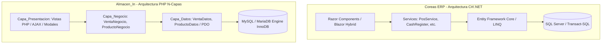
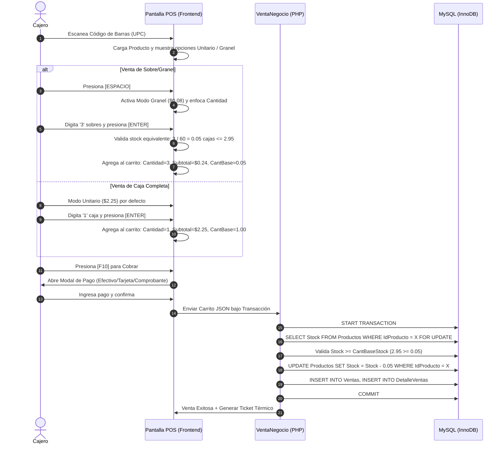
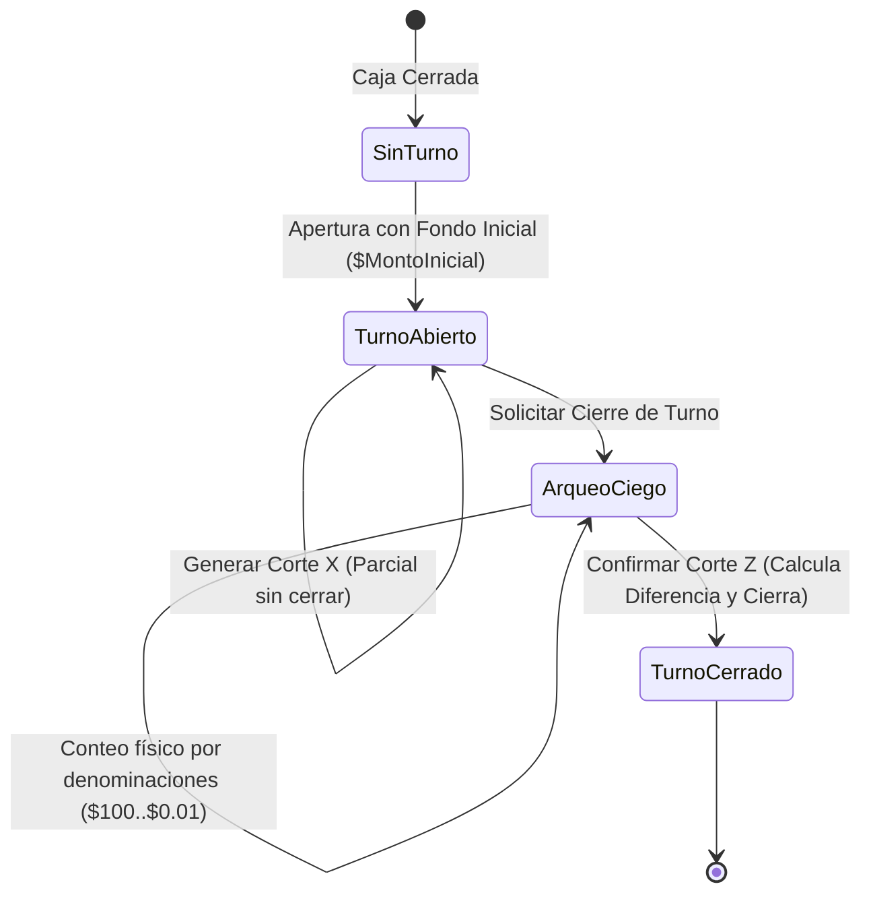
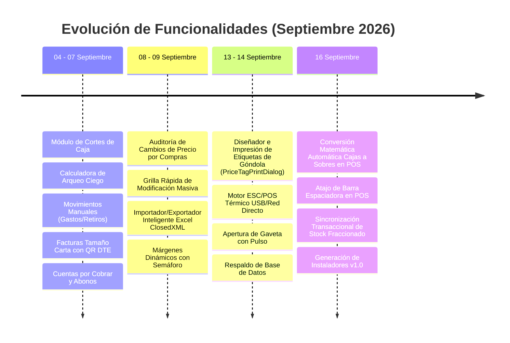

# DOCUMENTACIÓN TÉCNICA MAESTRA: ARQUITECTURA, PANTALLAS, LÓGICA DE NEGOCIO Y GUÍA DE REPLICACIÓN EN ALMACEN_IN

> **Fecha de Emisión:** 24 de Septiembre de 2026  
> **Sistema Origen:** Coreas ERP (.NET MAUI / Blazor Hybrid / SQL Server)  
> **Sistema Destino:** Almacen_In (PHP / MySQL / Arquitectura N-Capas)  
> **Propósito:** Documentar exhaustivamente cada pantalla, modal, regla transaccional y flujo de negocio implementado desde el **04 de Septiembre de 2026 a la fecha**, sirviendo como guía definitiva paso a paso para replicar e integrar estas funcionalidades en la aplicación web `almacen_in`.

---

## TABLA DE CONTENIDOS
1. [Resumen Ejecutivo y Arquitectura Comparativa](#1-resumen-ejecutivo-y-arquitectura-comparativa)
2. [Esquema de Base de Datos y Script de Migración SQL](#2-esquema-de-base-de-datos-y-script-de-migración-sql)
3. [Navegación, Menú Principal y Matriz de Roles](#3-navegación-menú-principal-y-matriz-de-roles)
4. [Catálogo Maestro de Pantallas (13 Módulos)](#4-catálogo-maestro-de-pantallas-13-módulos)
5. [Catálogo Exhaustivo de Modales y Diálogos (20 Modales)](#5-catálogo-exhaustivo-de-modales-y-diálogos-20-modales)
6. [Lógica de Negocio y Reglas Transaccionales Núcleo](#6-lógica-de-negocio-y-reglas-transaccionales-núcleo)
   - 6.1 Lógica de Inventario, Empaque y Venta a Granel (Fórmula Clorets)
   - 6.2 Lógica de POS y Facturación
   - 6.3 Lógica de Facturación Electrónica DTE (El Salvador / FelSV)
   - 6.4 Lógica de Compras y Proveedores
   - 6.5 Lógica de Turnos de Caja, Arqueos y Cuadres Ciegos
   - 6.6 Lógica de Cuentas por Cobrar y Abonos
   - 6.7 Auditoría de Precios e Impresión de Etiquetas
7. [Cronología y Bitácora de Cambios (04 al 24 de Septiembre)](#7-cronología-y-bitácora-de-cambios-04-al-24-de-septiembre)
8. [Guía de Replicación e Integración Paso a Paso en Almacen_In (PHP / MySQL)](#8-guía-de-replicación-e-integración-paso-a-paso-en-almacen_in-php--mysql)

---

## 1. Resumen Ejecutivo y Arquitectura Comparativa

### 1.1 Visión General
El sistema **Coreas ERP** es una solución integral para comercios minoristas y mayoristas en El Salvador, combinando control de almacén, compras, terminal de punto de venta (POS) de alta velocidad, arqueos de caja supervisados, cuentas por cobrar y facturación electrónica oficial (DTE) homologada ante el Ministerio de Hacienda (MH).

La aplicación web **Almacen_In** es el equivalente web modular desarrollado en **PHP** siguiendo un patrón estructurado en capas:
- `Capa_Entidades`: Clases POPO (Plain Old PHP Objects) que modelan los datos.
- `Capa_Datos`: Clases DAO con sentencias preparadas mediante `PDO` para interactuar con la base de datos.
- `Capa_Negocio`: Reglas de validación, cálculos financieros, control de inventario y transacciones ACID.
- `Capa_Presentacion`: Vistas HTML5, componentes Blade/PHP, hojas de estilo CSS y controladores JavaScript/AJAX.



---

## 2. Esquema de Base de Datos y Script de Migración SQL

Para que `almacen_in` soporte todas las funcionalidades desarrolladas desde el 4 de septiembre, su base de datos debe contener las tablas y columnas exactas que se detallan a continuación.

### 2.1 Diccionario de Tablas Principales

#### Tabla `Productos` (Inventario Maestro con Multi-Empaque)
| Campo | Tipo SQL | Descripción |
| :--- | :--- | :--- |
| `IdProducto` | INT AUTO_INCREMENT PK | Identificador único |
| `IdCategoria` | INT NOT NULL FK | Categoría del producto |
| `Codigo` | VARCHAR(100) UNIQUE | Código de barras (EAN-13, UPC o interno) |
| `Nombre` | VARCHAR(150) NOT NULL | Nombre descriptivo del artículo |
| `Descripcion` | TEXT NULL | Notas o detalles adicionales |
| `PrecioCompra` | DECIMAL(10,2) NOT NULL | Costo de adquisición de la unidad base/empaque |
| `PrecioVenta` | DECIMAL(10,2) NOT NULL | Precio de venta al público de la unidad base/empaque |
| `PrecioGranel` | DECIMAL(10,2) NULL | **[Nuevo]** Precio de venta de la fracción/sobre individual |
| `CostoGranel` | DECIMAL(10,4) NULL | **[Nuevo]** Costo proporcional unitario (`PrecioCompra / CantidadPorEmpaque`) |
| `CantidadPorEmpaque`| DECIMAL(10,2) DEFAULT 1.00 | **[Nuevo]** Cantidad de piezas/sobres por empaque completo (ej: 60) |
| `Stock` | DECIMAL(12,3) NOT NULL | Existencias físicas reales expresadas en unidad base/cajas |
| `StockMinimo` | DECIMAL(12,3) DEFAULT 5.00 | Umbral de alerta de reabastecimiento |
| `EsGranel` | BOOLEAN DEFAULT 0 | **[Nuevo]** 1 = Permite venta menudeo/sobres o decimales |
| `UnidadMedida` | VARCHAR(30) DEFAULT 'Unidad' | 'Unidad', 'Caja', 'Sobre', 'Paquete', 'Libra', 'Kilogramo' |
| `MargenExcepcion` | DECIMAL(5,2) DEFAULT 0.00 | Margen mínimo tolerado antes de lanzar alerta |
| `Imagen` / `ImagenUrl` | VARCHAR(500) NULL | Ruta o URL de la fotografía del producto |
| `Estado` | BOOLEAN DEFAULT 1 | 1 = Activo, 0 = Inactivo/Descontinuado |
| `FechaCreacion` | DATETIME DEFAULT CURRENT_TIMESTAMP | Fecha de registro |

#### Tabla `Ventas` (Comprobantes y Transmisión DTE)
| Campo | Tipo SQL | Descripción |
| :--- | :--- | :--- |
| `IdVenta` | INT AUTO_INCREMENT PK | Llave primaria |
| `IdCliente` | INT NOT NULL FK | Cliente comprador (`1` = Consumidor Final) |
| `IdUsuario` | INT NOT NULL FK | Cajero/Vendedor responsable |
| `TipoComprobante`| VARCHAR(30) NOT NULL | 'Ticket', 'Factura', 'Credito Fiscal', 'Anticipo', 'Cotización' |
| `NumComprobante` | VARCHAR(50) NOT NULL | Correlativo local (`T-YYYYMMDD-XXXX`, etc.) |
| `NumeroControl` | VARCHAR(35) NULL | **[DTE]** Formato MH: `DTE-01-M001P001-000000000000101` |
| `CodigoGeneracion`| VARCHAR(36) NULL | **[DTE]** UUID v4 único generado por la aplicación |
| `SelloRecepcion` | VARCHAR(100) NULL | **[DTE]** Sello criptográfico retornado por Hacienda |
| `EstadoDte` | VARCHAR(30) DEFAULT 'No_Aplica' | 'No_Aplica', 'Pendiente', 'Transmitido', 'Rechazado', 'Contingencia' |
| `MetodoPago` | VARCHAR(50) DEFAULT 'Efectivo' | 'Efectivo', 'Tarjeta', 'Transferencia', 'Credito' |
| `Subtotal` | DECIMAL(10,2) NOT NULL | Monto sin IVA (en El Salvador: `Total / 1.13`) |
| `Impuesto` | DECIMAL(10,2) NOT NULL | Monto del IVA (13% incluido: `Total - Subtotal`) |
| `Total` | DECIMAL(10,2) NOT NULL | Importe total facturado |
| `PagoCon` | DECIMAL(10,2) NULL | Efectivo entregado por el cliente |
| `Cambio` | DECIMAL(10,2) NULL | Vuelto entregado |
| `Estado` | VARCHAR(30) DEFAULT 'Completada' | 'Completada', 'Anulada', 'Cotización' |
| `FechaHora` | DATETIME DEFAULT CURRENT_TIMESTAMP | Fecha y hora exacta de la transacción |

#### Tabla `DetalleVentas`
| Campo | Tipo SQL | Descripción |
| :--- | :--- | :--- |
| `IdDetalle` | INT AUTO_INCREMENT PK | Identificador del ítem |
| `IdVenta` | INT NOT NULL FK | Relación con la Venta cabecera |
| `IdProducto` | INT NOT NULL FK | Relación con el Producto |
| `Cantidad` | DECIMAL(12,3) NOT NULL | Cantidad de piezas/sobres o empaques vendidos |
| `Precio` | DECIMAL(10,2) NOT NULL | Precio unitario aplicado (PrecioVenta o PrecioGranel) |
| `Descuento` | DECIMAL(10,2) DEFAULT 0.00 | Descuento en dólares aplicado a la línea |
| `Subtotal` | DECIMAL(10,2) NOT NULL | `(Cantidad * Precio) - Descuento` |

#### Tabla `CortesCaja` (Turnos y Arqueo Ciego)
| Campo | Tipo SQL | Descripción |
| :--- | :--- | :--- |
| `IdCorte` | INT AUTO_INCREMENT PK | Identificador del turno |
| `IdUsuario` | INT NOT NULL FK | Cajero asignado al turno |
| `MontoInicial` | DECIMAL(10,2) NOT NULL | Fondo de caja inicial entregado para dar vuelto |
| `TotalVentas` | DECIMAL(10,2) DEFAULT 0.00 | Total acumulado de ventas cobradas en efectivo |
| `MontoFinal` | DECIMAL(10,2) NULL | Conteo físico del dinero en gaveta reportado al cierre |
| `Diferencia` | DECIMAL(10,2) DEFAULT 0.00 | `MontoFinal - MontoEsperado` (+ Sobrante, - Faltante) |
| `Estado` | VARCHAR(20) DEFAULT 'Abierta' | 'Abierta' o 'Cerrada' |
| `FechaApertura` | DATETIME DEFAULT CURRENT_TIMESTAMP | Apertura del turno |
| `FechaCierre` | DATETIME NULL | Momento en que se ejecuta el Corte Z |

#### Tabla `MovimientosCaja` (Entradas, Salidas y Gaveta)
| Campo | Tipo SQL | Descripción |
| :--- | :--- | :--- |
| `IdMovimiento` | INT AUTO_INCREMENT PK | Identificador |
| `IdCorte` | INT NULL FK | Turno activo donde ocurrió el movimiento |
| `IdUsuario` | INT NOT NULL FK | Usuario que autorizó o realizó el movimiento |
| `Tipo` | VARCHAR(30) NOT NULL | 'Ingreso', 'Egreso', 'AperturaGaveta' |
| `Monto` | DECIMAL(10,2) NOT NULL | Cuantía de dinero (o 0.00 si es apertura de gaveta) |
| `Motivo` | VARCHAR(255) NOT NULL | Justificación del gasto, retiro o auditoría |
| `FechaHora` | DATETIME DEFAULT CURRENT_TIMESTAMP | Marca de tiempo |

#### Tabla `CuentasCobrar` y `Abonos` (Créditos a Clientes)
- **`CuentasCobrar`:** `IdCuentaCobrar`, `IdVenta` (FK), `IdCliente` (FK), `MontoTotal`, `SaldoPendiente`, `FechaEmision`, `FechaVencimiento`, `Estado` ('Pendiente', 'Pagada').
- **`Abonos`:** `IdAbono`, `IdCuentaCobrar` (FK), `IdUsuario` (FK), `Monto`, `MetodoPago`, `FechaHora`, `Notas`.

#### Tabla `CambiosPrecio` (Auditoría de Variación de Costos y Precios)
- **`CambiosPrecio`:** `IdCambioPrecio`, `IdProducto` (FK), `IdUsuario` (FK), `PrecioAnterior`, `PrecioNuevo`, `CostoAnterior`, `CostoNuevo`, `FechaHora`, `Motivo`, `Estado` ('Pendiente', 'Aplicado').

---

### 2.2 Script de Migración SQL para `almacen_in` (MySQL / MariaDB)

Ejecuta el siguiente bloque SQL en la base de datos de `almacen_in` para sincronizar las columnas y tablas necesarias:

```sql
-- 1. Actualización de tabla Productos para soporte de menudeo/granel y márgenes
ALTER TABLE `Productos` 
ADD COLUMN IF NOT EXISTS `PrecioGranel` DECIMAL(10, 2) NULL AFTER `PrecioVenta`,
ADD COLUMN IF NOT EXISTS `CostoGranel` DECIMAL(10, 4) NULL AFTER `PrecioGranel`,
ADD COLUMN IF NOT EXISTS `CantidadPorEmpaque` DECIMAL(10, 2) NOT NULL DEFAULT 1.00 AFTER `CostoGranel`,
ADD COLUMN IF NOT EXISTS `EsGranel` TINYINT(1) NOT NULL DEFAULT 0 AFTER `CantidadPorEmpaque`,
ADD COLUMN IF NOT EXISTS `UnidadMedida` VARCHAR(30) NOT NULL DEFAULT 'Unidad' AFTER `EsGranel`,
ADD COLUMN IF NOT EXISTS `MargenExcepcion` DECIMAL(5, 2) NOT NULL DEFAULT 0.00 AFTER `UnidadMedida`,
ADD COLUMN IF NOT EXISTS `ImagenUrl` VARCHAR(500) NULL AFTER `MargenExcepcion`;

-- 2. Asegurar precisión decimal para existencias fraccionadas
ALTER TABLE `Productos` MODIFY COLUMN `Stock` DECIMAL(12, 3) NOT NULL DEFAULT 0.000;
ALTER TABLE `Productos` MODIFY COLUMN `StockMinimo` DECIMAL(12, 3) NOT NULL DEFAULT 5.000;
ALTER TABLE `DetalleVentas` MODIFY COLUMN `Cantidad` DECIMAL(12, 3) NOT NULL DEFAULT 1.000;

-- 3. Actualización de tabla Ventas para DTE (Factura Electrónica El Salvador)
ALTER TABLE `Ventas`
ADD COLUMN IF NOT EXISTS `NumeroControl` VARCHAR(35) NULL AFTER `NumComprobante`,
ADD COLUMN IF NOT EXISTS `CodigoGeneracion` VARCHAR(36) NULL AFTER `NumeroControl`,
ADD COLUMN IF NOT EXISTS `SelloRecepcion` VARCHAR(100) NULL AFTER `CodigoGeneracion`,
ADD COLUMN IF NOT EXISTS `EstadoDte` VARCHAR(30) NOT NULL DEFAULT 'No_Aplica' AFTER `SelloRecepcion`,
ADD COLUMN IF NOT EXISTS `DteId` VARCHAR(50) NULL AFTER `EstadoDte`,
ADD COLUMN IF NOT EXISTS `RespuestaHacienda` TEXT NULL AFTER `DteId`;

-- 4. Creación de tabla CortesCaja si no existe
CREATE TABLE IF NOT EXISTS `CortesCaja` (
  `IdCorte` INT AUTO_INCREMENT PRIMARY KEY,
  `IdUsuario` INT NOT NULL,
  `MontoInicial` DECIMAL(10, 2) NOT NULL DEFAULT 0.00,
  `TotalVentas` DECIMAL(10, 2) NOT NULL DEFAULT 0.00,
  `MontoFinal` DECIMAL(10, 2) NULL,
  `Diferencia` DECIMAL(10, 2) NOT NULL DEFAULT 0.00,
  `Estado` VARCHAR(20) NOT NULL DEFAULT 'Abierta',
  `FechaApertura` DATETIME NOT NULL DEFAULT CURRENT_TIMESTAMP,
  `FechaCierre` DATETIME NULL,
  KEY `fk_corte_usuario` (`IdUsuario`)
) ENGINE=InnoDB DEFAULT CHARSET=utf8mb4;

-- 5. Creación de tabla MovimientosCaja si no existe
CREATE TABLE IF NOT EXISTS `MovimientosCaja` (
  `IdMovimiento` INT AUTO_INCREMENT PRIMARY KEY,
  `IdCorte` INT NULL,
  `IdUsuario` INT NOT NULL,
  `Tipo` VARCHAR(30) NOT NULL, -- 'Ingreso', 'Egreso', 'AperturaGaveta'
  `Monto` DECIMAL(10, 2) NOT NULL DEFAULT 0.00,
  `Motivo` VARCHAR(255) NOT NULL,
  `FechaHora` DATETIME NOT NULL DEFAULT CURRENT_TIMESTAMP,
  KEY `fk_mov_corte` (`IdCorte`),
  KEY `fk_mov_usuario` (`IdUsuario`)
) ENGINE=InnoDB DEFAULT CHARSET=utf8mb4;

-- 6. Creación de tabla CuentasCobrar y Abonos
CREATE TABLE IF NOT EXISTS `CuentasCobrar` (
  `IdCuentaCobrar` INT AUTO_INCREMENT PRIMARY KEY,
  `IdVenta` INT NOT NULL,
  `IdCliente` INT NOT NULL,
  `MontoTotal` DECIMAL(10, 2) NOT NULL,
  `SaldoPendiente` DECIMAL(10, 2) NOT NULL,
  `FechaEmision` DATETIME NOT NULL DEFAULT CURRENT_TIMESTAMP,
  `FechaVencimiento` DATETIME NOT NULL,
  `Estado` VARCHAR(20) NOT NULL DEFAULT 'Pendiente',
  KEY `fk_cc_venta` (`IdVenta`),
  KEY `fk_cc_cliente` (`IdCliente`)
) ENGINE=InnoDB DEFAULT CHARSET=utf8mb4;

CREATE TABLE IF NOT EXISTS `Abonos` (
  `IdAbono` INT AUTO_INCREMENT PRIMARY KEY,
  `IdCuentaCobrar` INT NOT NULL,
  `IdUsuario` INT NOT NULL,
  `Monto` DECIMAL(10, 2) NOT NULL,
  `MetodoPago` VARCHAR(50) NOT NULL DEFAULT 'Efectivo',
  `FechaHora` DATETIME NOT NULL DEFAULT CURRENT_TIMESTAMP,
  `Notas` VARCHAR(255) NULL,
  KEY `fk_abono_cc` (`IdCuentaCobrar`),
  KEY `fk_abono_usuario` (`IdUsuario`)
) ENGINE=InnoDB DEFAULT CHARSET=utf8mb4;

-- 7. Creación de tabla CambiosPrecio (Auditoría)
CREATE TABLE IF NOT EXISTS `CambiosPrecio` (
  `IdCambioPrecio` INT AUTO_INCREMENT PRIMARY KEY,
  `IdProducto` INT NOT NULL,
  `IdUsuario` INT NOT NULL,
  `PrecioAnterior` DECIMAL(10, 2) NOT NULL,
  `PrecioNuevo` DECIMAL(10, 2) NOT NULL,
  `CostoAnterior` DECIMAL(10, 2) NOT NULL,
  `CostoNuevo` DECIMAL(10, 2) NOT NULL,
  `FechaHora` DATETIME NOT NULL DEFAULT CURRENT_TIMESTAMP,
  `Motivo` VARCHAR(255) NULL,
  `Estado` VARCHAR(20) NOT NULL DEFAULT 'Aplicado',
  KEY `fk_cp_producto` (`IdProducto`),
  KEY `fk_cp_usuario` (`IdUsuario`)
) ENGINE=InnoDB DEFAULT CHARSET=utf8mb4;
```

---

## 3. Navegación, Menú Principal y Matriz de Roles

### 3.1 Estructura del Menú (`NavMenu`)
La barra lateral del sistema actúa como eje de navegación principal:
1. **Encabezado:** Marca y subtítulo (`Coreas ERP - Control de Inventario & Ventas`).
2. **Badge Dinámico de Alerta:** Muestra en tiempo real un contador en color rojo junto a la opción *Inventario Productos* con la cantidad de artículos cuyo `Stock <= StockMinimo`.
3. **Pie de Barra Lateral:**
   - Botón rojo **Cerrar Sistema** (limpia token/sesión y redirige al Login).
   - Tarjeta del usuario logueado con avatar circular, nombre y rol actual.

### 3.2 Matriz de Acceso por Roles
| Opción del Menú | Ruta Web | Administrador | Supervisor | Cajero |
| :--- | :--- | :---: | :---: | :---: |
| **Inicio (Dashboard)** | `/` o `/dashboard` | Sí | Sí | No |
| **Administración Usuarios** | `/usuarios` | Sí | No | No |
| **Administración Clientes** | `/clientes` | Sí | Sí | No |
| **Inventario Productos** | `/inventario` | Sí | Sí | No |
| **Compras a Proveedores** | `/compras` | Sí | Sí | No |
| **POS - Punto de Ventas** | `/pos` | **Sí** | **Sí** | **Sí** |
| **Cambio de Precios** | `/cambios-precio` | Sí | Sí | No |
| **Promociones y Ofertas** | `/promociones` | Sí | Sí | No |
| **Configuración General** | `/configuracion` | Sí | No | No |
| **Cuentas por Cobrar** | `/cuentas-cobrar` | Sí | Sí | No |
| **Historial de Ventas** | `/ventas` | Sí | Sí | No |
| **Cortes y Arqueos de Caja** | `/cortes` | Sí | Sí | Acceso vía POS |

> [!IMPORTANT]
> **Modo Restringido para Cajero:** Cuando un usuario con rol *Cajero* inicia sesión, la aplicación lo redirige **directamente a `/pos`**. No ve las opciones de configuración, compras, usuarios ni finanzas en la barra lateral. Si necesita abrir la gaveta sin venta, el sistema le exige autorización de Supervisor mediante PIN modal.

---

## 4. Catálogo Maestro de Pantallas (13 Módulos)

A continuación se detalla la lógica completa, consultas, comportamiento y reglas de cada pantalla del sistema:

---

### Pantalla 1: Login de Acceso (`/login`)
- **Propósito:** Autenticar empleados, verificar estado activo y establecer sesión con permisos.
- **Campos del Formulario:**
  - `Usuario`: Nombre de usuario (sensible o insensible a mayúsculas).
  - `Clave`: Contraseña protegida (hasheada en backend con BCrypt o SHA-256).
- **Lógica de Ejecución:**
  1. El backend busca al usuario por nombre en la base de datos: `WHERE Usuario = :user AND Estado = 1`.
  2. Compara el hash de la clave ingresada.
  3. Si es válido, carga la relación con el `Rol` y genera las variables de sesión (`$_SESSION['user_id']`, `$_SESSION['user_role']`, etc.).
  4. Redirección condicional:
     - Si `Rol == 'Cajero'` $\rightarrow$ redirige a `/pos`.
     - Si `Rol == 'Administrador'` o `'Supervisor'` $\rightarrow$ redirige a `/` (Dashboard).
  5. Si falla, incrementa contador de intentos fallidos y muestra mensaje claro: *"Usuario o contraseña incorrectos"*.

---

### Pantalla 2: Dashboard / Inicio (`/`)
- **Propósito:** Panel analítico de control gerencial en tiempo real.
- **KPIs y Tarjetas Superiores:**
  - **Ventas del Día ($):** Sumatoria de ventas completadas con fecha de hoy (`WHERE Estado = 'Completada' AND DATE(FechaHora) = CURDATE()`).
  - **Margen Global de Ganancia (%):** Rentabilidad estimada basada en `(TotalVenta - TotalCosto) / TotalCosto`.
  - **Tickets Emitidos Hoy:** Conteo de transacciones cerradas hoy.
  - **Productos en Alerta de Stock:** Total de ítems con `Stock <= StockMinimo`.
- **Gráficas y Tablas:**
  - Gráfica de ingresos de los últimos 7 días.
  - **Top 6 Productos Más Vendidos:** Agrupación por `IdProducto` sumando cantidades en `DetalleVentas`.
  - Tabla de últimos movimientos de caja y ventas recientes.

---

### Pantalla 3: Terminal Punto de Venta / POS (`/pos`)
*Es el corazón operativo del comercio. Diseñado para operar 100% con teclado físico sin obligar al uso del ratón.*



- **Lógica de la Fila de Edición y Atajos:**
  - **Celda UPC:** Al presionar [ENTER] con un código escaneado:
    1. Si no existe en el catálogo, lanza alerta sonora y visual.
    2. Si existe, verifica que `Stock > 0`.
    3. Carga el producto en la fila de edición temporal.
    4. **El campo de Cantidad aparece VACÍO** y con foco automático (evita sobre-escritura accidental del número `1`).
  - **La Barra Espaciadora [ESPACIO]:**
    - Si el producto tiene configurado `PrecioGranel`: alterna entre **Modo Unidad/Caja** (PrecioVenta) y **Modo Granel/Sobre** (PrecioGranel).
    - Cambia visualmente la píldora activa de color primario (azul) a éxito (verde).
    - Actualiza el precio mostrado en tiempo real.
  - **Confirmación con [ENTER] en Cantidad:**
    - Lee la cantidad solicitada `C`.
    - Si está en Modo Granel y `CantidadPorEmpaque > 1`:
      $$\text{CantidadBase} = \frac{C}{\text{CantidadPorEmpaque}}$$
    - Valida que la suma de lo que ya está en el carrito para ese producto más `CantidadBase` sea $\le \text{Stock Actual}$.
    - Si es válido, lo añade a la tabla del carrito; si no, lanza alerta: *"Existencias insuficientes. Disponibles: X sobres (Y cajas)"*.
  - **Otros Atajos Globales del POS:**
    - `[F2]`: Abre el modal de Búsqueda Avanzada de Productos.
    - `[F4]`: Abre el modal de Registro Rápido de Clientes.
    - `[F10]`: Abre el modal de Cobro y Facturación.
    - `[Escape]`: Cancela la edición actual o cierra modales abiertos.

---

### Pantalla 4: Inventario y Productos (`/inventario` o `/productos`)
- **Propósito:** Gestión maestra de catálogo, altas, modificaciones, precios, costos y stock.
- **Características:**
  - Barra de búsqueda reactiva por código, nombre o descripción.
  - Filtro por categoría y selector de filtro rápido (*Todos*, *Solo con Stock*, *Stock Bajo/Agotado*).
  - Indicador de margen comercial unitario con semáforo de colores:
    - $\ge 20\%$: Verde (Excelente margen).
    - Entre $1\%$ y $19.99\%$: Amarillo (Margen ajustado).
    - $\le 0\%$: Rojo (Venta a pérdida o costo no configurado).
  - **Botonera Superior:**
    - `+ Nuevo Producto`: Abre `ProductModal` en modo inserción.
    - `Nueva Categoría`: Modal express de familias de productos.
    - `Importar Inventario`: Abre modal para cargar Excel `.xlsx` masivo.
    - `Exportar Excel`: Genera y descarga el catálogo completo con todas las columnas de empaque y stock en milisegundos.

---

### Pantalla 5: Historial de Ventas (`/ventas`)
- **Propósito:** Auditoría fiscal, seguimiento de ingresos, reimpresión y anulación.
- **Filtros:**
  - Selector de Fecha desde/hasta.
  - Buscador por número de comprobante, código de generación DTE o cliente.
- **Acciones por Venta:**
  - **Ver Detalle:** Abre `SaleDetailModal` con el desglose exacto de ítems.
  - **Ticket Térmico:** Abre `TicketPreviewDialog` para reimprimir el ticket en 58mm u 80mm.
  - **Factura Carta:** Abre `InvoiceLetterModal` para visualizar e imprimir en formato PDF tamaño carta con sellos DTE y desglose fiscal.
  - **Anular Venta:** Ejecuta reversión transaccional completa:
    1. Si fue vendida a precio granel, devuelve al stock la fracción exacta: $\text{Stock} = \text{Stock} + (C / \text{PiezasPorEmpaque})$.
    2. Si fue venta normal, reintegra la cantidad completa: $\text{Stock} = \text{Stock} + C$.
    3. Cambia estado de la venta a `'Anulada'`.
    4. Si tenía DTE transmitido a Hacienda, dispara evento de invalidación extemporánea.

---

### Pantalla 6: Compras a Proveedores (`/compras`)
- **Propósito:** Registrar ingresos de mercadería, actualizar costos de compra y elevar existencias.
- **Flujo de Operación:**
  1. Clic en `+ Nueva Compra` $\rightarrow$ abre `PurchaseModal`.
  2. Se selecciona el Proveedor y se ingresa el Número de Factura del proveedor.
  3. Se agregan líneas buscando el producto por código o con el buscador `[F2]`.
  4. Por cada ítem se define: `Cantidad Comprada` y `Precio de Compra Unitario`.
  5. Al confirmar la compra bajo transacción:
     - Se guarda el registro en `Compras` y `DetalleCompras`.
     - **El inventario físico del producto se incrementa automáticamente:** `Stock = Stock + CantidadComprada`.
     - **Se actualiza el costo base:** `PrecioCompra = NuevoPrecioCompra`.
     - Si el producto tiene `CantidadPorEmpaque > 1`, se recalcula en automático su `CostoGranel`:
       $$\text{CostoGranel} = \frac{\text{NuevoPrecioCompra}}{\text{CantidadPorEmpaque}}$$
     - Si el nuevo costo afecta el margen de ganancia, se encola una sugerencia en el módulo de `CambiosPrecio`.

---

### Pantalla 7: Administración de Clientes (`/clientes`)
- **Propósito:** Directorio unificado de compradores y asignación de créditos.
- **Clasificación:**
  - **Persona Natural:** Valida `DUI` (formato `00000000-0`).
  - **Persona Jurídica (Empresa):** Requiere obligatoriamente `NIT`, `NRC` (Número de Registro de Contribuyente) y `Giro` (Actividad económica) para la emisión válida de Comprobantes de Crédito Fiscal DTE.

---

### Pantalla 8: Gestión de Categorías (`/categorias`)
- **Propósito:** Mantenimiento de familias de artículos (Bebidas, Golosinas, Abarrotes, Limpieza, Farmacia, etc.).
- Permite habilitar o inhabilitar familias completas sin borrar los productos asociados.

---

### Pantalla 9: Ajustes & Cambio de Precios (`/cambios-precio`)
- **Propósito:** Control de precios al público y prevención de pérdidas cuando los proveedores incrementan costos.
- **Pestaña 1: Pendientes por Compras:**
  - Muestra una tabla con todos los productos cuyo costo subió en la última compra registrada y cuyo precio de venta actual genera un margen inferior al configurado.
  - Permite con un solo clic calcular el nuevo precio sugerido respetando el margen deseado y aplicarlo en lote.
- **Pestaña 2: Edición Masiva de Catálogo:**
  - Grilla interactiva tipo Excel donde el supervisor puede modificar precios de venta rápidamente y guardar 50 productos de una sola vez.
- **Pestaña 3: Historial de Auditoría:**
  - Registro inmutable de quién modificó qué precio, fecha, costo anterior/nuevo y precio anterior/nuevo.

---

### Pantalla 10: Promociones y Ofertas (`/promociones`)
- **Propósito:** Campañas de descuento por fechas de vigencia.
- Permite aplicar descuentos porcentuales (`10%`, `15%`) o precios fijos a productos específicos o categorías enteras durante un rango temporal (`FechaInicio` a `FechaFin`).

---

### Pantalla 11: Control de Turnos & Cortes de Caja (`/cortes`)
*Módulo de control de efectivo y prevención de fugas de dinero.*



- **Apertura de Turno:** El cajero ingresa el fondo para dar vuelto (ej: `$50.00`). No puede realizar cobros en el POS si no ha abierto turno.
- **Movimientos de Caja:** Botones rápidos para registrar:
  - `Entrada de Efectivo`: Cambio adicional traído del banco.
  - `Salida de Efectivo`: Pago de proveedor de paso, compra de insumos, retiro de excedentes.
- **Arqueo Ciego y Corte Z:**
  - Al cerrar turno, se abre `ArqueoEfectivoModal`.
  - El cajero **NO sabe cuánto dinero espera el sistema** (evita manipulación de conteo).
  - Digita cuántos billetes de cada valor tiene en gaveta.
  - El sistema calcula la diferencia:
    $$\text{Esperado} = \text{MontoInicial} + \text{VentasEfectivo} + \text{AbonosEfectivo} + \text{Entradas} - \text{Salidas}$$
    $$\text{Diferencia} = \text{TotalFísico} - \text{Esperado}$$
  - Si `Diferencia < 0` $\rightarrow$ Faltante (alerta roja). Si `> 0` $\rightarrow$ Sobrante (alerta amarilla). Si `0.00` $\rightarrow$ Caja cuadrada (verde).

---

### Pantalla 12: Cuentas por Cobrar y Abonos (`/cuentas-cobrar`)
- **Propósito:** Gestión de ventas al fiado/crédito y anticipos.
- Lista los clientes con deudas activas, días de vencimiento transcurridos y botón para abonar.
- Al registrar un abono parcial, descuenta `SaldoPendiente` e ingresa el efectivo directamente al turno de caja activo del cajero.

---

### Pantalla 13: Configuración del Sistema (`/configuracion`)
- **Propósito:** Ajustes fiscales, de hardware y parámetros de red.
- **Secciones:**
  1. **Datos de la Empresa:** Nombre Comercial, Razón Social, NIT, NRC, Giro, Dirección, Teléfono y Correo.
  2. **Facturación Electrónica (DTE):** Switch para habilitar/deshabilitar DTE, Código de Establecimiento (`M001`), Código de Punto de Venta (`P001`), Token y Tenant de conexión con API FelSV.
  3. **Impresora Térmica:** Selección de impresora de Windows o IP de red, selección de ancho de papel (`58mm` u `80mm`), switches para *Impresión Automática al Cobrar* y *Apertura Automática de Gaveta con Pulso ESC/POS*.

---

## 5. Catálogo Exhaustivo de Modales y Diálogos (20 Modales)

En la siguiente tabla se especifican todos los modales del sistema, qué pantalla los invoca y su comportamiento para replicarlos en la capa de presentación de `almacen_in`:

| # | Modal | Componente Origen | Propósito y Comportamiento Clave |
| :--- | :--- | :--- | :--- |
| **1** | `ProductModal` | `Productos.razor` | Formulario maestro de producto. Incluye switch de venta a granel, cálculo reactivo de margen unitario y piezas por empaque. Generador automático de código de barras de 13 dígitos. |
| **2** | `ProductSearchModal` | `Pos.razor`, `PurchaseModal` | Buscador flotante `[F2]` con tabla rápida de productos, indicador de stock y selector con teclado (flechas y Enter). |
| **3** | `PaymentDialog` | `Pos.razor` | Modal de Cobro `[F10]`. Selección de comprobante, cálculo automático de vuelto en efectivo y selección de cliente. |
| **4** | `TicketPreviewDialog` | `Pos.razor`, `Ventas.razor` | Vista previa del ticket térmico en formato monoespaciado (58mm/80mm), QR oficial DTE y envío a impresión física. |
| **5** | `InvoiceLetterModal` | `Pos.razor`, `Ventas.razor` | Comprobante fiscal tamaño carta (Factura / Crédito Fiscal) con tabla formal de impuestos, retenciones y número a letras. |
| **6** | `PriceTagPrintDialog` | `Productos.razor`, `CambiosPrecio` | Diseñador e impresor masivo de etiquetas de precios para estantes con códigos de barras Code128 y precios destacados. |
| **7** | `SaleDetailModal` | `Ventas.razor` | Visor informativo de una venta completada: lista de ítems, totales, estado de transmisión DTE y cajero. |
| **8** | `PurchaseModal` | `Compras.razor` | Formulario de cabecera y detalle para ingresar facturas de proveedores con incremento de existencias. |
| **9** | `QuickCustomerModal` | `Pos.razor` | Modal express `[F4]` para dar de alta a un cliente en 3 campos sin salir del punto de venta ni perder el carrito. |
| **10**| `QuickSupplierModal` | `PurchaseModal.razor` | Creación rápida de proveedor dentro de la pantalla de compras. |
| **11**| `CustomerModal` | `Clientes.razor` | Ficha completa de cliente con validaciones de persona natural/jurídica, DUI, NIT, NRC y Giro comercial. |
| **12**| `CategoryModal` | `Productos.razor`, `Categorias` | Creación y edición de categorías de productos con nombre y descripción. |
| **13**| `PromoModal` | `Promociones.razor` | Configurador de ofertas con fechas de inicio y fin, productos aplicables y porcentaje de descuento. |
| **14**| `UserModal` | `Usuarios.razor` | Alta y modificación de credenciales de personal interno y asignación de rol (`Administrador`, `Supervisor`, `Cajero`). |
| **15**| `ArqueoEfectivoModal` | `Cortes.razor` | Calculadora interactiva de monedas y billetes ($100 a $0.01) para el cuadre ciego al momento de cerrar turno. |
| **16**| `CorteTicketModal` | `Cortes.razor` | Impresión térmica de los reportes oficiales de arqueo: Corte X (turno en curso) o Corte Z (cierre final). |
| **17**| `CashDrawerAuthModal`| `Pos.razor` | Diálogo de seguridad que solicita PIN o contraseña de Supervisor para abrir la gaveta sin haber hecho una venta. |
| **18**| `AbonoModal` | `CuentasCobrar.razor` | Formulario para ingresar pagos a cuentas de crédito: monto abonado, método de pago y notas de recibo. |
| **19**| `ContingencyModal` | `Ventas.razor`, `Configuracion`| Panel para transmitir por lotes comprobantes DTE que quedaron pendientes por caída de internet o fallas de Hacienda. |
| **20**| `DbConfigModal` | `Configuracion.razor` | Formulario de configuración de credenciales de conexión al servidor de base de datos SQL. |

---

## 6. Lógica de Negocio y Reglas Transaccionales Núcleo

Aquí se detallan los algoritmos y fórmulas matemáticas más importantes que rigen el sistema:

### 6.1 Lógica de Inventario, Empaque y Venta a Granel (Fórmula Clorets)
Esta es la innovación clave implementada para manejar productos que se adquieren en empaque cerrado pero se menudean por piezas:

#### Regla de Configuración del Producto:
- El producto se almacena en la base de datos con su **unidad mayor** (ej: Caja o Dispensador).
- `Stock`: Existencia en cajas completas y decimales (ej: `2.95` cajas = 2 cajas y 57 sobres).
- `CantidadPorEmpaque`: Cantidad de piezas contenidas en una caja completa (ej: `60.00`).
- `PrecioVenta`: Precio al público de la caja completa (ej: `$2.25`).
- `PrecioGranel`: Precio al público de una pieza o sobre suelto (ej: `$0.08`).

#### Algoritmo de Venta en POS:
```
SI EsModoGranelActivo == VERDADERO Y CantidadPorEmpaque > 1 ENTONCES:
    FactorConversion = CantidadPorEmpaque
    CantidadBaseAValidar = CantidadDigitada / FactorConversion
SINO:
    FactorConversion = 1.00
    CantidadBaseAValidar = CantidadDigitada
FIN SI

StockEquivalenteEnCarrito = Sumatoria(ItemsMismoProducto.CantidadBase)
NuevoStockRequerido = StockEquivalenteEnCarrito + CantidadBaseAValidar

SI NuevoStockRequerido > Producto.Stock ENTONCES:
    Lanzar Error: "Stock insuficiente"
SINO:
    Agregar al carrito
    Cobro al cliente = CantidadDigitada * PrecioGranel
    Descuento físico del inventario al confirmar venta = CantidadBaseAValidar
FIN SI
```

#### Ejemplo Numérico Real:
- Stock en BD: **`2.95` cajas** (equivale a $2.95 \times 60 = 177$ sobres).
- El cajero activa modo Granel y digita `3` sobres.
- Cálculo de fracción: $\frac{3}{60} = \mathbf{0.05 \text{ cajas}}$.
- Verificación: $0.05 \le 2.95 \implies$ **¡Aprobado!**
- Cobro: $3 \times \$0.08 = \mathbf{\$0.24}$.
- Nuevo Stock en BD: $2.95 - 0.05 = \mathbf{2.90 \text{ cajas}}$.

---

### 6.2 Lógica de POS y Facturación
- **Desglose de IVA en El Salvador (13% incluido):**
  $$\text{Subtotal (Neto Gravado)} = \text{Redondear}\left(\frac{\text{Total}}{1.13}, 2\right)$$
  $$\text{IVA (13\%)} = \text{Total} - \text{Subtotal}$$
- **Vuelto o Cambio:**
  $$\text{Cambio} = \text{PagoCon} - \text{Total}$$
  *(Solo aplica si el método de pago es Efectivo y PagoCon > Total; en tarjeta o transferencia el cambio siempre es $0.00$)*.

---

### 6.3 Lógica de Turnos de Caja y Cuadre Ciego
Al momento del cierre, el sistema compara el dinero que debería haber contra el conteo físico del cajero:

$$\text{MontoEsperado} = \text{MontoInicial} + \text{VentasEfectivo} + \text{AbonosEfectivo} + \text{EntradasEfectivo} - \text{SalidasEfectivo}$$
$$\text{Diferencia} = \text{MontoFísicoContado} - \text{MontoEsperado}$$

- **`Diferencia == 0.00`:** Cuadre exacto.
- **`Diferencia < 0.00`:** Faltante de dinero en caja (se registra en el corte para descuento al empleado).
- **`Diferencia > 0.00`:** Sobrante de dinero en caja.

---

## 7. Cronología y Bitácora de Cambios (04 al 24 de Septiembre)

Para tu auditoría y réplica en `almacen_in`, este es el resumen cronológico de todo lo implementado en este periodo:



---

## 8. Guía de Replicación e Integración Paso a Paso en Almacen_In (PHP / MySQL)

Para incorporar esta lógica en tu proyecto web `Almacen_In`, sigue estos pasos estructurados por capas:

### Paso 1: Actualizar la Entidad `Producto.php` (`Capa_Entidades/Producto.php`)
Agrega los nuevos atributos y sus getters/setters:

```php
<?php
// Capa_Entidades/Producto.php

class Producto {
    public $IdProducto;
    public $IdCategoria;
    public $Codigo;
    public $Nombre;
    public $Descripcion;
    public $PrecioCompra;
    public $PrecioVenta;
    public $PrecioGranel;
    public $CostoGranel;
    public $CantidadPorEmpaque = 1.00;
    public $Stock = 0.000;
    public $StockMinimo = 5.000;
    public $EsGranel = false;
    public $UnidadMedida = 'Unidad';
    public $MargenExcepcion = 0.00;
    public $Estado = true;

    // Calcula el costo fraccionado unitario
    public function getCostoEfectivoGranel() {
        if ($this->CostoGranel > 0) {
            return $this->CostoGranel;
        }
        if ($this->CantidadPorEmpaque > 0 && $this->PrecioCompra > 0) {
            return round($this->PrecioCompra / $this->CantidadPorEmpaque, 4);
        }
        return $this->PrecioCompra;
    }
}
```

---

### Paso 2: Implementar la Lógica Transaccional en `VentaNegocio.php` (`Capa_Negocio/VentaNegocio.php`)
Este método procesa el carrito, descuenta la fracción correcta de inventario con bloqueo `FOR UPDATE` y guarda la venta:

```php
<?php
// Capa_Negocio/VentaNegocio.php
require_once __DIR__ . '/../Capa_Datos/Conexion.php';

class VentaNegocio {

    public function registrarVenta($idCliente, $idUsuario, $tipoComprobante, $metodoPago, $pagoCon, $items) {
        if (empty($items)) {
            return ['success' => false, 'message' => 'El carrito está vacío.'];
        }

        $conexion = Conexion::obtenerConexion();
        
        try {
            $conexion->beginTransaction();

            // 1. Validar y descontar existencias físicas
            foreach ($items as $item) {
                $stmt = $conexion->prepare("SELECT Stock, CantidadPorEmpaque, Nombre FROM Productos WHERE IdProducto = :id FOR UPDATE");
                $stmt->execute([':id' => $item['id_producto']]);
                $prod = $stmt->fetch(PDO::FETCH_ASSOC);

                if (!$prod) {
                    $conexion->rollBack();
                    return ['success' => false, 'message' => "Producto ID {$item['id_producto']} no encontrado."];
                }

                // Cálculo fraccionado según regla Clorets
                $esGranel = !empty($item['es_granel']);
                $cantEmpaque = floatval($prod['CantidadPorEmpaque']);
                $factor = ($esGranel && $cantEmpaque > 1) ? $cantEmpaque : 1.00;
                $cantBaseADescontar = floatval($item['cantidad']) / $factor;

                if (floatval($prod['Stock']) < $cantBaseADescontar) {
                    $conexion->rollBack();
                    return [
                        'success' => false, 
                        'message' => "Stock insuficiente para '{$prod['Nombre']}'. Disponible: {$prod['Stock']}, solicitado equivalente: {$cantBaseADescontar}."
                    ];
                }

                // Descontar inventario físico
                $updateStock = $conexion->prepare("UPDATE Productos SET Stock = Stock - :cant WHERE IdProducto = :id");
                $updateStock->execute([
                    ':cant' => $cantBaseADescontar,
                    ':id' => $item['id_producto']
                ]);
            }

            // 2. Cálculos financieros (IVA 13% incluido)
            $total = 0;
            foreach ($items as $item) {
                $total += (floatval($item['cantidad']) * floatval($item['precio'])) - floatval($item['descuento'] ?? 0);
            }
            $subtotal = round($total / 1.13, 2);
            $impuesto = round($total - $subtotal, 2);
            $cambio = ($metodoPago === 'Efectivo' && $pagoCon > $total) ? round($pagoCon - $total, 2) : 0.00;

            // 3. Generar número de correlativo
            $numComprobante = 'T-' . date('Ymd') . '-' . strtoupper(substr(uniqid(), -4));

            // 4. Insertar cabecera de Venta
            $sqlVenta = "INSERT INTO Ventas (IdCliente, IdUsuario, TipoComprobante, NumComprobante, MetodoPago, Subtotal, Impuesto, Total, PagoCon, Cambio, Estado)
                         VALUES (:idCliente, :idUsuario, :tipo, :num, :metodo, :sub, :imp, :tot, :pago, :cambio, 'Completada')";
            $stmtV = $conexion->prepare($sqlVenta);
            $stmtV->execute([
                ':idCliente' => $idCliente,
                ':idUsuario' => $idUsuario,
                ':tipo' => $tipoComprobante,
                ':num' => $numComprobante,
                ':metodo' => $metodoPago,
                ':sub' => $subtotal,
                ':imp' => $impuesto,
                ':tot' => $total,
                ':pago' => $pagoCon,
                ':cambio' => $cambio
            ]);
            $idVenta = $conexion->lastInsertId();

            // 5. Insertar Detalles de Venta
            $sqlDetalle = "INSERT INTO DetalleVentas (IdVenta, IdProducto, Cantidad, Precio, Descuento, Subtotal)
                           VALUES (:idVenta, :idProd, :cant, :precio, :desc, :sub)";
            $stmtD = $conexion->prepare($sqlDetalle);

            foreach ($items as $item) {
                $subLinea = (floatval($item['cantidad']) * floatval($item['precio'])) - floatval($item['descuento'] ?? 0);
                $stmtD->execute([
                    ':idVenta' => $idVenta,
                    ':idProd' => $item['id_producto'],
                    ':cant' => $item['cantidad'],
                    ':precio' => $item['precio'],
                    ':desc' => $item['descuento'] ?? 0.00,
                    ':sub' => $subLinea
                ]);
            }

            // 6. Si hubo turno de caja activo y pago en efectivo, sumar al turno
            if ($metodoPago === 'Efectivo') {
                $stmtCorte = $conexion->prepare("UPDATE CortesCaja SET TotalVentas = TotalVentas + :total WHERE IdUsuario = :idUser AND Estado = 'Abierta'");
                $stmtCorte->execute([':total' => $total, ':idUser' => $idUsuario]);
            }

            $conexion->commit();
            return [
                'success' => true, 
                'message' => 'Venta registrada exitosamente.', 
                'id_venta' => $idVenta,
                'comprobante' => $numComprobante
            ];

        } catch (Exception $e) {
            $conexion->rollBack();
            return ['success' => false, 'message' => 'Error transaccional: ' . $e->getMessage()];
        }
    }
}
```

---

### Paso 3: Controlador JavaScript para Atajos del POS (`Capa_Presentacion/js/pos-shortcuts.js`)
Copia este script en tu vista web del POS para que el cajero tenga exactamente la misma agilidad operativa con la tecla **[Espacio]** y **[F10]**:

```javascript
// Capa_Presentacion/js/pos-shortcuts.js

let productoEnEdicion = null;
let esModoGranelActivo = false;

document.addEventListener('keydown', function(e) {
    // Si estamos editando la cantidad de un producto
    const inputCantidad = document.getElementById('posInputCantidad');
    const inputUpc = document.getElementById('posInputUpc');

    if (document.activeElement === inputCantidad) {
        // [BARRA ESPACIADORA]: Alternar entre Caja/Empaque y Granel/Sobre
        if (e.code === 'Space' || e.key === ' ') {
            e.preventDefault();
            toggleModoGranel();
            return;
        }
        // [ENTER]: Agregar al carrito
        if (e.key === 'Enter') {
            e.preventDefault();
            confirmarAgregarAlCarrito();
            return;
        }
        // [ESCAPE]: Cancelar producto en edición
        if (e.key === 'Escape') {
            e.preventDefault();
            cancelarEdicion();
            return;
        }
    }

    // [F10]: Abrir ventana de cobro
    if (e.key === 'F10') {
        e.preventDefault();
        abrirModalCobro();
    }

    // [F2]: Abrir buscador de productos
    if (e.key === 'F2') {
        e.preventDefault();
        abrirModalBuscador();
    }
});

function toggleModoGranel() {
    if (!productoEnEdicion || !productoEnEdicion.PrecioGranel || productoEnEdicion.PrecioGranel <= 0) {
        alert("Este producto no tiene precio a granel/sobre configurado.");
        return;
    }

    esModoGranelActivo = !esModoGranelActivo;
    const precioEl = document.getElementById('posPrecioMostrado');
    const pillGranel = document.getElementById('pillModoGranel');
    const pillUnidad = document.getElementById('pillModoUnidad');

    if (esModoGranelActivo) {
        precioEl.value = '$' + parseFloat(productoEnEdicion.PrecioGranel).toFixed(2);
        pillGranel.classList.add('btn-success', 'active');
        pillUnidad.classList.remove('btn-primary', 'active');
    } else {
        precioEl.value = '$' + parseFloat(productoEnEdicion.PrecioVenta).toFixed(2);
        pillUnidad.classList.add('btn-primary', 'active');
        pillGranel.classList.remove('btn-success', 'active');
    }
}
```

---

## 9. Conclusión y Recomendaciones de Implementación

1. **Prioridad de Replicación:**
   - **Fase 1:** Ejecutar el script SQL de migración en la base de datos de `almacen_in`.
   - **Fase 2:** Implementar la lógica de conversión fraccionada en `VentaNegocio.php` y en la vista del POS (`pos-shortcuts.js`).
   - **Fase 3:** Implementar el módulo de Cortes de Caja con la calculadora visual de denominaciones ($100 a $0.01) para asegurar el cuadre ciego del turno.
   - **Fase 4:** Migrar la plantilla de tickets térmicos con códigos QR oficiales.
2. **Integridad de Datos:**
   - Nunca descuentes inventario sin antes ejecutar `BEGIN TRANSACTION` y `SELECT ... FOR UPDATE` en MySQL para prevenir inconsistencias en ventas concurrentes.
3. **Mantenimiento:**
   - Conserva este documento como referencia de ingeniería para cualquier auditoría o futura versión multiplataforma del sistema.
